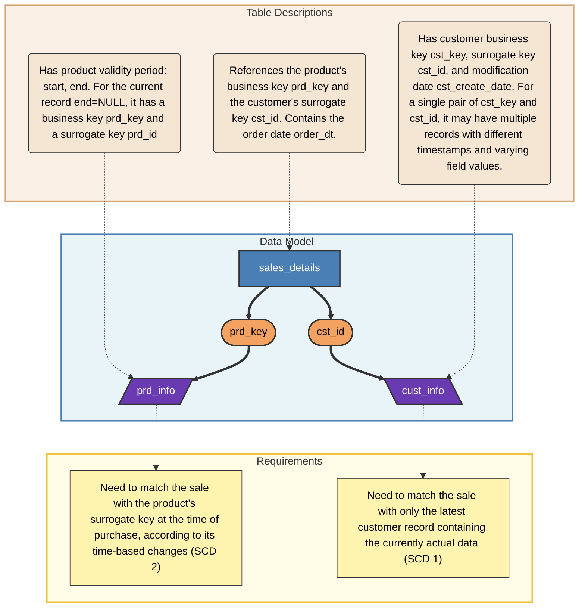
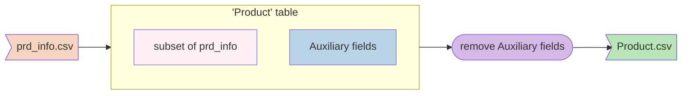
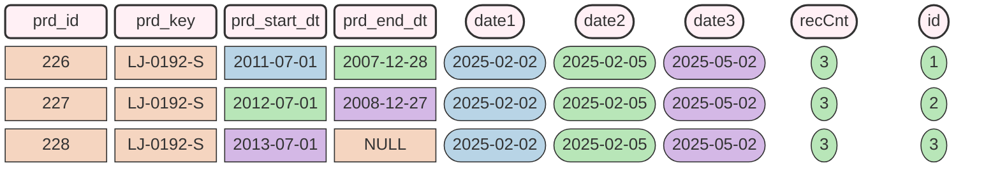

# Preparing Clean Data for a DWH

<p align="right">
<i>"On two occasions I have been asked, 'Pray, Mr. Babbage, if you put into the machine wrong figures, will the right answers come out?' I am not able rightly to apprehend the kind of confusion of ideas that could provoke such a question."</i>
<br>Charles Babbage, 1864
</p>

The "Product-Sales-Customer" model is a classic example of a star schema for a Data Warehouse (DWH) according to Ralph Kimball's methodology. The underlying business process is intuitively understandable to almost anyone.

When developing an ETL pipeline (data transformation pipeline), a data engineer needs reliable source data on which to safely design and debug the logic.

An excellent dataset for such tasks can be found in the GitHub repository prepared by Baraa Khatib Salkini: [sql-data-warehouse-project](https://github.com/DataWithBaraa/sql-data-warehouse-project).

The source data is stored in the `01_datasets/source_crm` directory, and its main structure can be described by the following diagram:



As can be seen from the diagram, the model consists of one fact table and two dimension tables. The "Product" dimension is implemented as a Slowly Changing Dimension Type 2 (SCD 2), meaning it stores the full history of changes. The "Customer" dimension, on the contrary, is implemented as a Slowly Changing Dimension Type 1 (SCD 1): it does not store history, but simply overwrites attributes, keeping only their current state.

Overall, this is an excellent dataset containing 18,495 customers, 397 products, and 60,398 records in the sales fact table.

However, in its raw form, this data has quality and integrity issues. The purpose of this article is to describe how to clean up this data so that it can be correctly used for DWH modeling and configuring the ETL pipeline.

## Data Structure Description

### "Product" Dimension (`prd_info` table)

| field        | description                        |
| ------------ | ---------------------------------- |
| prd_id       | surrogate product key              |
| prd_key      | product business key               |
| prd_nm       | product name                       |
| prd_cost     | product cost                       |
| prd_line     | product line                       |
| prd_start_dt | validity period start date         |
| prd_end_dt   | validity period end date           |

For different validity periods of the same product, the business key remains unchanged, while the surrogate key changes. The currently active record has a `NULL` value in the end date field.

Example of the first few records from the table:

| prd_id | prd_key          | prd_nm                    | prd_cost | prd_line | prd_start_dt | prd_end_dt |
| -----: | :--------------- | :------------------------ | -------: | :------: | :----------- | :--------- |
|    210 | CO-RF-FR-R92B-58 | HL Road Frame - Black- 58 |          |    R     | 2003-07-01   | *NULL*     |
|    211 | CO-RF-FR-R92R-58 | HL Road Frame - Red- 58   |          |    R     | 2003-07-01   | *NULL*     |
|    212 | AC-HE-HL-U509-R  | Sport-100 Helmet- Red     |       12 |    S     | 2011-07-01   | 2007-12-28 |
|    213 | AC-HE-HL-U509-R  | Sport-100 Helmet- Red     |       14 |    S     | 2012-07-01   | 2008-12-27 |
|    214 | AC-HE-HL-U509-R  | Sport-100 Helmet- Red     |       13 |    S     | 2013-07-01   | *NULL*     |

Right here, we can already notice data quality issues:
* The product cost is missing in the first two rows.
* The validity period end date is earlier than its start date.
* Even if we swap these dates, the validity periods will still overlap.

Let's note these errors as tasks that require fixing directly in the data.

### "Customer" Dimension (`cust_info` table)

| field              | description                              |
| ------------------ | ---------------------------------------- |
| cst_id             | surrogate customer key                   |
| cst_key            | customer business key                    |
| cst_firstname      | customer first name                      |
| cst_lastname       | customer last name                       |
| cst_marital_status | customer marital status                  |
| cst_gndr           | customer gender                          |
| cst_create_date    | attribute creation or update date        |

Example of a few records from the table (at the beginning and in the middle of the sample):

| cst_id | cst_key    | cst_firstname | cst_lastname | cst_marital_status | cst_gndr | cst_create_date |
| -----: | :--------- | :------------ | :----------- | :----------------: | :------: | :-------------- |
|  11000 | AW00011000 | Jon           | Yang         |         M          |    M     | 2025-10-06      |
|  11001 | AW00011001 | Eugene        | Huang        |         S          |    M     | 2025-10-02      |
|  29466 | AW00029466 | *NULL*        | *NULL*       |         M          |  *NULL*  | 2026-01-25      |
|  29466 | AW00029466 | Lance         | Jimenez      |         M          |  *NULL*  | 2026-01-26      |
|  29466 | AW00029466 | Lance         | Jimenez      |         M          |    M     | 2026-01-27      |

It is worth noting here that this is a Type 1 SCD dimension. For the same combination of surrogate and business keys, there are multiple records, but for analytics, only the latest one (with the maximum date) should be used.

### "Sales" Fact Table (`sales_details` table)

| field        | description                  |
| ------------ | ---------------------------- |
| sls_ord_num  | order business key           |
| sls_prd_key  | product business key         |
| sls_cust_id  | surrogate customer key       |
| sls_order_dt | order date                   |
| sls_ship_dt  | shipping date                |
| sls_due_dt   | planned delivery date        |
| sls_quantity | quantity                     |
| sls_price    | price per unit               |
| sls_sales    | sales amount                 |

Example of a few records from the table (at the beginning and in the middle of the sample):

| sls_ord_num | sls_prd_key | sls_cust_id | sls_order_dt | sls_ship_dt | sls_due_dt | sls_sales | sls_quantity | sls_price |
|:------------|:------------|------------:|:------------:|:-----------:|:----------:|----------:|-------------:|----------:|
| SO43697     | BK-R93R-62  |       21768 |   20101229   |  20110105   |  20110110  |      3578 |            1 |      3578 |
| SO43698     | BK-M82S-44  |       28389 |   20101229   |  20110105   |  20110110  |      3400 |            1 |      3400 |
| SO43699     | BK-M82S-44  |       25863 |   20101229   |  20110105   |  20110110  |      3400 |            1 |      3400 |
| SO51181     | HL-U509-R   |       12132 |   20121228   |  20130104   |  20130109  |        35 |            1 |        35 |
| SO51182     | BK-R79Y-42  |       22998 |   20121228   |  20130104   |  20130109  |      1701 |            1 |      1701 |

The following features are noticeable here:
* The product key in the fact table is shortened: `HL-U509-R` is used instead of the full key `AC-HE-HL-U509-R`.
* Dates are presented in a different format: without using a hyphen as a separator.
* The product cost does not match: the fact table shows a price of 35, while the maximum price for this product in the product dimension is 13.

The answer to the first observation lies in the data structure: the product category is encoded at the beginning of the product dimension's business key. This can be seen in the category reference file `source_erp/PX_CAT_G1V2.csv`, which contains the following information:

| ID    | CAT         | SUBCAT  | MAINTENANCE |
| :---- | :---------- | :------ | :---------: |
| AC_HE | Accessories | Helmets | Yes         |

## Data Correction

So, we have reviewed the data structure and identified errors within it. Our task is to correct this data.

But first, we will simplify the structure to leave only three entities, as shown in the diagram above:

* We will remove categories and the product line. With these additional attributes, the data schema would turn into a "Snowflake" schema, so for simplicity, we will omit them. To do this:
    * Remove the `prd_line` field from the `prd_info` table.
    * Cut the first 6 characters from the business key `prd_key`, leaving only the product code.
* Remove the `cst_marital_status` and `cst_gndr` fields from the `cust_info` table for the same reason.

We will perform all operations in a SQLite database, as the data volume is relatively small and a single-user engine is more than enough for us. The correction process can be described by the following diagram using the `prd_info` table as an example:



The sequence of actions is as follows:
* Import the `prd_info` table from the `prd_info.csv` file.
* Copy the required fields into the `Product` table, where we also create several auxiliary fields. In doing so, some fields are populated immediately during the copy process.
* Using a sequence of queries, we populate the remaining auxiliary fields by generating the necessary data in them.
* Then, we update the main data, using the auxiliary fields as variables for the correction algorithms.
* Upon completion of the correction, before writing to files, we delete the auxiliary fields. Since they may also be needed for correcting other tables (e.g., the fact table), they are deleted only after all tables have been processed.

It should be noted that the majority of the data that needs to be corrected consists of dates. We will regenerate them randomly, but in a way that keeps them consistent. The SQLite query language does not support procedural programming (variables, conditions, loops), so the initial constants for dates and their ranges can be set using a CTE (Common Table Expression):

```SQL
WITH 
bounds AS (
    SELECT 
        '2025-01-01' AS A,  -- Start date
        365 AS B            -- Generation interval in days
)
```
Here we set the start date `bounds.A` (`2025-01-01`) and the generation range for the entire year of 2025 - 365 days from the start date (`bounds.B`).
Now, let's look at the data correction for each table separately.

### Correction of `cust_info` Table Data

#### Analysis of `cust_info` Table Data

Let's load the data from the `cust_info.csv` file into a database table, for example `data_fix.db` (the name can be anything), specifying that missing values during import should be replaced with `NULL`.

After that, let's run a simple analytical query:

```SQL
SELECT 
  COUNT(*) AS TotalRows,
  COUNT(DISTINCT cst_id) AS UniqueIds,
  COUNT(DISTINCT cst_key) AS UniqueKeys,
  COUNT(DISTINCT cst_id || '_' || cst_key) AS UniqueIdAndKey,
  COUNT(*) - COUNT(cst_id) AS IdNullCount,
  COUNT(*) - COUNT(cst_key) AS KeyNullCount,
  COUNT(*) - COUNT(cst_create_date) AS CreatedDateNullCount
FROM cust_info;
```

Results:

| TotalRows | UniqueIds | UniqueKeys | UniqueIdAndKey | IdNullCount | KeyNullCount | CreatedDateNullCount |
|----------:|----------:|-----------:|---------------:|------------:|-------------:|---------------------:|
|     18494 |     18484 |      18488 |          18484 |           4 |            0 |                    4 |

As you can see from the results, we have four rows with an empty surrogate key, while there are no rows with an empty business key.

These rows can be displayed separately by running the query `SELECT * FROM cust_info WHERE cst_id IS NULL`:

| cst_id | cst_key  | cst_firstname | cst_lastname | cst_marital_status | cst_gndr | cst_create_date |
|-------:|:---------|:--------------|:-------------|:------------------:|:--------:|:----------------|
|        | SF566    |               |              |                    |          |                 |
|        | PO25     |               |              |                    |          |                 |
|        | 13451235 |               |              |                    |          |                 |
|        | A01Ass   |               |              |                    |          |                 |

It is evident that, apart from business keys, there are no other attributes for these records. All empty values are `NULL`.

All these rows can be safely deleted from the table, as the fact table uses the surrogate key to link with customers, which is absent in these records. That is, these records will not affect the facts in any way.

Let's modify the query to exclude such records and count duplicates:

```SQL
SELECT 
  COUNT(*) AS TotalRows,
  COUNT(DISTINCT cst_id) AS UniqueIds,
  COUNT(DISTINCT cst_key) AS UniqueKeys,
  COUNT(DISTINCT cst_id || '_' || cst_key) AS UniqueIdAndKey,
  COUNT(*) - COUNT(DISTINCT cst_id) AS IdDuplicatesCount,
  COUNT(*) - COUNT(DISTINCT cst_key) AS KeyDuplicatesCount,
  COUNT(*) - COUNT(DISTINCT cst_id || '_' || cst_key) AS IdAndKeyDuplicatesCount,
  COUNT(*) - COUNT(cst_create_date) AS CreatedDateNullCount
FROM cust_info
WHERE cst_id IS NOT NULL;
```

Result:

| TotalRows | UniqueIds | UniqueKeys | UniqueIdAndKey | IdDuplicatesCount | KeyDuplicatesCount | IdAndKeyDuplicatesCount | CreatedDateNullCount |
|----------:|----------:|-----------:|---------------:|------------------:|-------------------:|------------------------:|---------------------:|
|     18490 |     18484 |      18484 |          18484 |                 6 |                  6 |                       6 |                    0 |

As you can see, there are six duplicate records based on the combination of surrogate and business keys. At the same time, when counting unique combinations, the duplicate rows themselves are also taken into account. The distribution of duplicates by their count for each surrogate key can be calculated as follows:

```SQL
SELECT
  cst_id,
  COUNT(*) AS dupsCount,
  MIN(cst_create_date) AS minCreationDate,
  MAX(cst_create_date) AS maxCreationDate,
  julianday(MAX(cst_create_date)) - julianday(MIN(cst_create_date)) AS maxDateDiff
FROM cust_info
WHERE cst_id IS NOT NULL
GROUP BY cst_id
HAVING COUNT(*) > 1;
```

Result:

| cst_id | dupsCount | minCreationDate | maxCreationDate | maxDateDiff |
|-------:|----------:|:---------------:|:---------------:|------------:|
|  29433 |         2 |    2026-01-25   |    2026-01-27   |           2 |
|  29449 |         2 |    2026-01-25   |    2026-01-26   |           1 |
|  29466 |         3 |    2026-01-25   |    2026-01-27   |           2 |
|  29473 |         2 |    2026-01-25   |    2026-01-26   |           1 |
|  29483 |         2 |    2026-01-25   |    2026-01-27   |           2 |

As you can see, the maximum number of duplicates for a single surrogate key can be 3. There is only one such group, while the rest contain two records each. The interval between creation dates in these groups is a maximum of two days.

Thus, if we generate records randomly within the year 2025, we can safely use a difference of one day for duplicates. Additionally, we have the ability to use sorting by creation date for ranking records.

Now we have all the necessary information to generate new modification dates for customers.

#### Creating the `Customer` Table

Earlier, we decided to remove the `cst_marital_status` and `cst_gndr` fields. Instead, we will add three auxiliary fields:

| Field   | Description                                     |
| ------- | ----------------------------------------------- |
| dupsCnt | Number of duplicates for the surrogate key      |
| dupNo   | Duplicate number, sorted by creation date       |
| newDate | New random creation date                        |

We save the new date in an additional column so we can verify the data without overwriting the original dates.

The full query looks like this:

```SQL
CREATE TABLE Customer AS
WITH
bounds AS (
    SELECT '2025-01-01' AS A, 365 AS B
)
SELECT 
  cst_id,
  cst_key,
  cst_firstname,
  cst_lastname,
  cst_create_date,
  COUNT(*) OVER(PARTITION BY cst_id) AS dupCnt,
  ROW_NUMBER() OVER(PARTITION BY cst_id ORDER BY cst_create_date ASC) AS dupNo,
  date(bounds.A, '+' || (ABS(RANDOM()) % bounds.B) || ' days') AS newDate
FROM cust_info, bounds
WHERE cst_id IS NOT NULL;
```

Now, all dates in the `newDate` column fall within the year 2025. However, for duplicates, they might not be sequential (i.e., not exactly one day apart), which is easy to see by running the query `SELECT * FROM Customer WHERE dupCnt > 1;`.

Since the number of duplicates does not exceed three, this situation can be fixed using two queries:

```SQL
UPDATE Customer
SET
   newDate = date(prev.newDate, '+1 days')
FROM Customer AS prev
WHERE Customer.cst_id = prev.cst_id
AND Customer.dupNo = 2
AND prev.dupNo = 1
AND prev.dupCnt > 1;

UPDATE Customer
SET
   newDate = date(prev.newDate, '+1 days')
FROM Customer AS prev
WHERE Customer.cst_id = prev.cst_id
AND Customer.dupNo = 3
AND prev.dupNo = 2
AND prev.dupCnt > 2;
```

After executing these queries, you can verify that the dates for duplicates of the same customer are spaced exactly one day apart.

There are two steps left. The first step will transfer the new date from the `newDate` field to the original `cst_create_date` field:

```SQL
UPDATE Customer
SET cst_create_date = newDate;
```

The following queries will remove the auxiliary fields that were used during the calculations:

```SQL
ALTER TABLE Customer DROP COLUMN dupCnt;
ALTER TABLE Customer DROP COLUMN dupNo;
ALTER TABLE Customer DROP COLUMN newDate;
```

The final verification query requires the `sales_details` fact table to be loaded into the database as well:

```SQL
SELECT * FROM sales_details
WHERE sls_cust_id NOT IN ( SELECT cst_id FROM Customer );
```

It returns no records. This means that all customers are used in the fact table, and nothing needs to be deleted from the "Customer" dimension.

Now, we can export the table to a `Customer.csv` file with column headers, keeping `NULL` values as empty strings.

This concludes the correction of the "Customer" dimension.

### Data Correction for the `prd_info` Table

#### Analysis of `prd_info` Table Data

First, let's check the table using a query similar to the initial statistics query for the `cust_info` table:

| TotalRows | UniqueIds | UniqueKeys | UniqueIdAndKey | IdNullCount | KeyNullCount | StartDateNullCount |
|----------:|----------:|-----------:|---------------:|------------:|-------------:|-------------------:|
|       397 |       397 |        295 |            397 |           0 |            0 |                  0 |

As you can see from the results, the number of unique surrogate keys equals the total number of rows in the table. Furthermore, the combination of the surrogate key and the business key is also unique across the entire table. There are no records with empty values for either the surrogate key or the business key. Moreover, there are no `NULL` values in the interval start date.

Note: all statistical queries are available in the repository within the `stat_queries.sql` file.

As for the number of possible intervals and whether they are open or closed, this data can be obtained using another statistical query:

```SQL
WITH group_stats AS (
    -- calc each group
    SELECT 
        prd_key,
        COUNT(*) AS TotalInGroup,
        MAX(prd_id) AS FinalPrdId
    FROM prd_info
    GROUP BY prd_key
),
final_null_stat AS
(
  -- add HasFinalNulls to check if last prd_end_dt is NULL
  SELECT 
     group_stats.prd_key,
     group_stats.TotalInGroup,
     CASE WHEN prd_info.prd_end_dt IS NULL THEN 1 ELSE 0 END AS HasFinalNulls 
  FROM group_stats
  INNER JOIN prd_info
    ON prd_info.prd_id = group_stats.FinalPrdId
)
SELECT 
    TotalInGroup,
    COUNT(*) AS groupsCount,
    COUNT(*) - SUM(HasFinalNulls) AS TotalNotNullEndDateCount,
    SUM(HasFinalNulls) AS TotalNullEndDateCount
FROM final_null_stat
GROUP BY TotalInGroup;
```

The query returns the following data:

| TotalInGroup | groupsCount | TotalNotNullEndDateCount | TotalNullEndDateCount |
| -----------: | ----------: | -----------------------: | --------------------: |
|            1 |         218 |                       80 |                   138 |
|            2 |          52 |                       18 |                    34 |
|            3 |          25 |                        0 |                    25 |

As you can see, the maximum number of records in a group is three. At the same time, all groups with three records have an open interval: the last `prd_end_dt` date is `NULL`. Among the groups with two records, there are both open and closed intervals, meaning they have a specific finite end date for `prd_end_dt`.

#### Creating the `Product` Table

To correctly generate intervals for products given these input conditions, we will need three random dates, and they must be sequential so that SCD 2 is filled correctly.

For this, in the processing table, we will introduce not one, but three dates, and we will fill them in a more complex way.

We will add seven auxiliary fields:

| field  | description                                                     |
| ------ | --------------------------------------------------------------- |
| recCnt | number of records in the group for the business key             |
| id     | sequential number of the record in the group, sorted by surrogate key |
| date1  | new random date 1                                               |
| date2  | new random date 2, such that date2 > date1                      |
| date3  | new random date 3, such that date3 > date2                      |
| min_dt | minimum new date among records in the group                     |
| max_dt | maximum new date among records in the group                     |

Since we have no duplicates, slightly different names are used for the number of records in the group and the sequential number of the record.

The full query looks like this:

```SQL
CREATE TABLE Product AS
SELECT 
  prd_id 
  , SUBSTR(prd_key, 7) AS prd_key
  , prd_nm
  , prd_cost
  , prd_start_dt
  , prd_end_dt
  , COUNT(*) OVER(PARTITION BY prd_key) AS recCnt
  , ROW_NUMBER() OVER ( PARTITION BY prd_key ORDER BY prd_id ASC) AS id
  , CAST(NULL AS TEXT) AS date1
  , CAST(NULL AS TEXT) AS date2
  , CAST(NULL AS TEXT) AS date3
  , CAST(NULL AS TEXT) AS min_dt
  , CAST(NULL AS TEXT) AS max_dt    
FROM prd_info;
```

We leave all new dates empty for now, we trim the business key to remove categories, and we do not include the product line.

We can immediately delete from the products those records that are not represented in the facts:

```SQL
DELETE FROM Product
WHERE prd_key NOT IN (SELECT sls_prd_key FROM sales_details);
```

This will delete 220 rows, leaving 177 that are linked to facts. This will also delete records with empty prices.

The next step is to generate three dates. Since procedural capabilities are not used, we can generate them for each business key using a recursive CTE with a limit of three rows. The result will be in the form of "sequential number-date", and this needs to be transposed into additional columns. SQLite does not support `PIVOT`, so we transpose manually using `FILTER` and aggregate functions:

```SQL
WITH RECURSIVE
-- 1. get unique business keys
target_list AS (
   SELECT DISTINCT prd_key
   FROM Product
),
-- 2. range for dates generation
bounds AS (
    SELECT '2025-01-01' AS A, 365 AS B
),
-- 3. recursive generator for each key
generator(prd_key, idx, date_result) AS (
    -- first date
    SELECT 
        t.prd_key, 
        1, 
        date(b.A, '+' || (ABS(RANDOM() + t.prd_key) % b.B) || ' days')
    FROM target_list t, bounds b
    UNION ALL
    -- next dates, up to 3 for each key
    SELECT 
        g.prd_key,
        g.idx + 1,
        date(b.A, '+' || (ABS(RANDOM() + g.idx) % b.B) || ' days')
    FROM generator g, bounds b
    WHERE g.idx < 3
),
-- 4. remove duplicates for each key
unique_dates AS (
    SELECT prd_key, date_result 
    FROM generator 
    GROUP BY prd_key, date_result
),
-- 5. final output with numbering (1, 2, 3) for each key
num_data AS ( 
 SELECT 
    prd_key,
    ROW_NUMBER() OVER (PARTITION BY prd_key ORDER BY date_result ASC) AS genId,
    date_result
 FROM unique_dates
)
,
final_data AS (
  SELECT prd_key,
    MAX(date_result) FILTER (WHERE genId = 1) AS [date1],
    MAX(date_result) FILTER (WHERE genId = 2) AS [date2],
    MAX(date_result) FILTER (WHERE genId = 3) AS [date3]
  FROM num_data
  GROUP BY prd_key
)
UPDATE Product
SET 
   date1 = final_data.date1
   , date2 = final_data.date2
   , date3 = final_data.date3
FROM final_data
WHERE Product.prd_key = final_data.prd_key;
```

*Note*: The random number generation algorithm used in the query does not guarantee the generation of all three sequential dates: there is a possibility that one or two dates may be `NULL` due to the random selection of the first date within the specified range. To verify this, use the following query:

```SQL
SELECT * FROM Product
WHERE date1 IS NULL OR date2 IS NULL OR date3 IS NULL;
```

If it returns any rows, the date generation query should be executed again.

Now we have the `date1`, `date2`, `date3` fields filled, and we need to fill `prd_start_dt` and `prd_end_dt` accordingly.

The following diagram shows how this is done for a group of three records with an open interval:



As you can see, we fill `prd_start_dt` from `date1` for the first record. The value from `date2` is used both for `prd_start_dt` of the second record and for `prd_end_dt` of the first. The value from `date3` is used both for `prd_start_dt` of the third record and for `prd_end_dt` of the second.

If we have a closed interval for two records, the same algorithm applies.

In the general case, here are three queries that implement this algorithm, taking into account records with `NULL`:

```SQL
UPDATE Product
SET
  prd_start_dt = date1
  ,prd_end_dt = CASE WHEN prd_end_dt IS NOT NULL THEN date2 ELSE NULL END
WHERE id = 1;

UPDATE Product
SET
  prd_start_dt = date2
  ,prd_end_dt = CASE WHEN prd_end_dt IS NOT NULL THEN date3 ELSE NULL END
WHERE id = 2;

UPDATE Product
SET
  prd_start_dt = date3
WHERE id = 3;
```

The presence of the auxiliary field `recCnt`, strictly speaking, is not required for the algorithm, but it allows you to quickly make slices by groups and verify its correctness.

The last fields `min_dt` and `max_dt` are not needed for correcting the `Product` table itself. They are used for correcting the sales table.

They are filled with a separate query, assuming that the maximum date for the generation range, if the interval is open - the last day of 2025:

```SQL
WITH _rngs AS
(
SELECT prd_key,
   MIN ( prd_start_dt ) AS mn,
   MAX ( COALESCE( prd_end_dt, '2025-12-31')) AS mx
FROM Product
GROUP BY prd_key
)
UPDATE Product
SET 
   min_dt = _rngs.mn
   , max_dt = _rngs.mx
FROM _rngs
WHERE Product.prd_key = _rngs.prd_key;
```

The `Product` table is ready for export. But we will not delete the auxiliary fields in it and export it until we correct the `Sales` table.

### Data Correction for `sales_details` Table

#### Analysis of `sales_details` Table Data

First, let's check the table using a query similar to the initial statistics query for the `cust_info` table:

```SQL
SELECT 
  COUNT(*) AS TotalRows,
  COUNT(DISTINCT sls_ord_num) AS UniqueIds,
  COUNT(DISTINCT sls_prd_key) AS UniqueProductKeys,
  COUNT(DISTINCT sls_cust_id) AS UniqueCustKeys,
  COUNT(DISTINCT sls_prd_key || '_' || sls_cust_id) AS UniqueProdAndCust,
  COUNT(*) - COUNT(sls_ord_num) AS IdsNullCount,
  COUNT(*) - COUNT(sls_prd_key) AS ProductKeysNullCount,
  COUNT(*) - COUNT(sls_cust_id) AS CustKeysNullCount,
  COUNT(*) - COUNT(sls_order_dt) AS OrderDateNullCount,
  COUNT(*) - COUNT(sls_quantity) AS QuantityNullCount
FROM sales_details;
```

Result:

| TotalRows | UniqueIds | UniqueProductKeys | UniqueCustKeys | UniqueProdAndCust | IdsNullCount | ProductKeysNullCount | CustKeysNullCount | OrderDateNullCount | QuantityNullCount |
|----------:|----------:|------------------:|---------------:|------------------:|-------------:|---------------------:|------------------:|-------------------:|------------------:|
|     60398 |     27659 |               130 |          18484 |             58922 |            0 |                    0 |                 0 |                  0 |                 0 |

As you can see, with 60,398 rows in the table, there are only 27,659 unique business keys. There are no records with empty business keys or records without references to products or customers. There are also no NULL values in the quantity of purchased goods or the order date.

The fact that there are fewer business keys deserves separate consideration. Let's generate statistics on the number of records per business key:

```SQL
WITH group_stats AS (
    -- calc each group
  SELECT 
    sls_ord_num,
    COUNT(*) AS groupCount
  FROM sales_details
  GROUP BY sls_ord_num
)
SELECT 
    groupCount AS TotalInGroup,
    COUNT(*) AS GroupsCount
FROM group_stats
GROUP BY groupCount;
```

Result:

| TotalInGroup | GroupsCount |
| -----------: | ----------: |
|            1 |        9668 |
|            2 |        8163 |
|            3 |        5870 |
|            4 |        3138 |
|            5 |         696 |
|            6 |         109 |
|            7 |          12 |
|            8 |           3 |

As you can see, there can be up to 8 records in a group with a single business key. An example of such a group:

| sls_ord_num | sls_prd_key | sls_cust_id | sls_order_dt | sls_ship_dt | sls_due_dt | sls_sales | sls_quantity | sls_price |
| :---------- | :---------- | ----------: | :----------: | :---------: | :--------: | --------: | -----------: | --------: |
| SO54115     | TI-T723     |       27202 |   20130309   |  20130316   |  20130321  |        29 |            1 |        29 |
| SO54115     | TT-T092     |       27202 |   20130309   |  20130316   |  20130321  |         5 |            1 |         5 |
| SO54115     | HY-1023-70  |       27202 |   20130309   |  20130316   |  20130321  |        55 |            1 |        55 |
| SO54115     | CL-9009     |       27202 |   20130309   |  20130316   |  20130321  |         8 |            1 |         8 |

It is obvious that one order represents a sale of several different products to one customer at once.

And these data can create a problem for us: for all four of these products, the date interval in which they are valid must overlap. And it is precisely in the interval of intersection of these dates that we need to generate a new order date from 2025. The same should be true for all groups except the group of one product, since there we can generate the order date directly from the product's interval.

To check this, we will create an additional table `sales_check`, into which we will take part of the data from the sales table and part of the data from the products table:

```SQL
CREATE TABLE sales_check
AS
SELECT 
 sls_ord_num
 ,sls_prd_key
 ,sls_cust_id
 , Product.min_dt
 , Product.max_dt
 , Product.recCnt AS recCntProduct
 , COUNT(*) OVER(PARTITION BY sls_ord_num) AS recCntSales
 , ROW_NUMBER() OVER ( PARTITION BY sls_ord_num ORDER BY sls_prd_key ASC) AS idSales
FROM sales_details
INNER JOIN Product 
  ON Product.prd_key = sales_details.sls_prd_key
  AND  Product.id = 1;
```

We take only one row from the products table by `Product.id = 1`, since the maximum and minimum dates are duplicated for all rows in the group by product change. Now we are only interested in the upper date for a group of more than one product:

```SQL
SELECT DISTINCT max_dt
FROM sales_check
WHERE recCntSales > 1;
```

This query will return a single value `2025-12-31`, which we set as the maximum for the current date of the open interval instead of `NULL` in the product table. Therefore, in order for all products in the group to be current, we need to take the maximum date from `min_dt` for generating a random purchase date and use the interval from it to `2025-12-31`.

Hence the recommendation: if you need to generate similar data after generating random product validity intervals according to SCD2, it makes sense for such orders with the purchase of several products at the same time to use an open interval for such products, so as not to have to regenerate dates for them.

If you change the condition to `WHERE recCntSales = 1`, you can see that there will be many different dates, which indicates a closed interval for many products. If you check the number of intervals for the product dimension `recCntProduct` for groups of more than one product, you can see that it includes the entire possible set from one to three.

#### Creating the `Sales` Table

Since dates are identical within an order, it makes sense to create a separate table `sales_groups_dates` for new dates specifically by order.

We will also include the following columns in it:

| field        | description                                        |
| ------------ | -------------------------------------------------- |
| recCntSales  | to control the group size                          |
| startDate    | start date of the new date generation interval     |
| endDate      | end date of the new date generation interval       |
| newOrderDate | new random order creation date                     |
| newShipDate  | new random shipping date                           |
| newDueDate   | new random planned delivery date                   |

Let's fill this table:

```SQL
CREATE TABLE sales_groups_dates
AS
WITH _maxD AS
(
  SELECT 
    sls_ord_num
    , MAX(min_dt) AS startD
  FROM sales_check
  GROUP BY sls_ord_num
)
SELECT 
  _maxD.sls_ord_num
  , sales_check.recCntSales
  , _maxD.startD AS startDate
  , sales_check.max_dt AS endDate
  , CAST(NULL AS TEXT) AS newOrderDate
  , CAST(NULL AS TEXT) AS newShipDate
  , CAST(NULL AS TEXT) AS newDueDate
FROM _maxD
INNER JOIN sales_check
 ON sales_check.sls_ord_num = _maxD.sls_ord_num
 AND sales_check.idSales = 1;
```

Let's verify that the maximum start date of the interval `startDate` is calculated correctly for both the case of a group and the case of a single product with a closed date:

```SQL
SELECT 
  sc.sls_ord_num
  ,sc.sls_prd_key
  ,sc.min_dt
  ,sc.max_dt 
  ,sd.recCntSales
  ,sd.startDate
  ,sd.endDate
FROM sales_check AS sc
INNER JOIN sales_groups_dates AS sd
  ON sd.sls_ord_num = sc.sls_ord_num
WHERE sc.sls_ord_num IN ( 'SO54115', 'SO43698');
```

Result:

| sls_ord_num | sls_prd_key |   min_dt   |   max_dt   | recCntSales | startDate  |  endDate   |
| :---------- | :---------- | :--------: | :--------: | ----------: | :--------: | :--------: |
| SO43698     | BK-M82S-44  | 2025-05-03 | 2025-06-14 |           1 | 2025-05-03 | 2025-06-14 |
| SO54115     | CL-9009     | 2025-03-14 | 2025-12-31 |           4 | 2025-05-10 | 2025-12-31 |
| SO54115     | HY-1023-70  | 2025-05-10 | 2025-12-31 |           4 | 2025-05-10 | 2025-12-31 |
| SO54115     | TI-T723     | 2025-02-18 | 2025-12-31 |           4 | 2025-05-10 | 2025-12-31 |
| SO54115     | TT-T092     | 2025-03-15 | 2025-12-31 |           4 | 2025-05-10 | 2025-12-31 |

As you can see, both for a group of 4 products and for a single product with a limited date, the start and end dates of the generation interval are calculated correctly.

Since we now have ranges for all groups, we can generate a random date from the range for the group:

```SQL
UPDATE sales_groups_dates
SET newOrderDate = 
  date(
    julianday(startDate) + 
     (abs(random()) % (julianday(endDate) - julianday(startDate) ))
  );
```

This code works for a group of one product as well.

Note: the code should not generate the end date of the interval, so we do not add one more day after the remainder of the division.

After generating the order date, we can randomly generate the shipping date and delivery date sequentially within a 4-day interval:

```SQL
UPDATE sales_groups_dates
SET newShipDate = date(newOrderDate, '+' || (1 + abs(random()) % 4) || ' days');

UPDATE sales_groups_dates
SET newDueDate = date(newShipDate, '+' || (1 + abs(random()) % 4) || ' days');
```

The following query will help verify the correctness of the newly generated dates:

```SQL
SELECT *
FROM sales_check
EXCEPT
SELECT sc.*
FROM sales_check as sc
INNER JOIN sales_groups_dates AS gd
  ON gd.sls_ord_num = sc.sls_ord_num
INNER JOIN Product AS pd
  ON sc.sls_prd_key = pd.prd_key
  AND gd.newOrderDate >=  pd.prd_start_dt
  and ( gd.newOrderDate < pd.prd_end_dt OR pd.prd_end_dt IS NULL)
;
```

We subtract from the selection from the entire `sales_check` table the results of the interval join query. Both subqueries between `EXCEPT` should return the same number of rows - 60,398, and the full query should return no rows. This means that for all products, a match was found based on the validity ranges.

Now we are ready to create the `Sales` table with the same format and key fields, but with different values, except for the value of the `sls_quantity` field:

```SQL
CREATE TABLE Sales
AS
SELECT
  sc.sls_ord_num,
  sc.sls_prd_key,
  sc.sls_cust_id,
  replace(gd.newOrderDate, '-', '') sls_order_dt,
  replace(gd.newShipDate, '-', '') AS sls_ship_dt,
  replace(gd.newDueDate, '-', '') AS sls_due_dt,
  CAST(pd.prd_cost AS INT) * CAST(sd.sls_quantity AS INT) AS sls_sales,
  CAST(sd.sls_quantity AS INT) AS sls_quantity,
  CAST(pd.prd_cost AS INT) AS sls_price

FROM sales_check as sc
INNER JOIN sales_groups_dates AS gd
  ON gd.sls_ord_num = sc.sls_ord_num
INNER JOIN sales_details AS sd
  ON  sd.sls_prd_key = sc.sls_prd_key
  AND  sd.sls_ord_num = sc.sls_ord_num
  AND  sd.sls_cust_id = sc.sls_cust_id
INNER JOIN Product AS pd
  ON sc.sls_prd_key = pd.prd_key
  AND gd.newOrderDate >=  pd.prd_start_dt
  and ( gd.newOrderDate < pd.prd_end_dt OR pd.prd_end_dt IS NULL)
;
```

We also recalculate both the price and the sales amount by quantity. We convert the dates to the same format as in the original table by removing the hyphen.

Using three queries, we can compare the old data with the new data:

```SQL
SELECT *
FROM Sales
WHERE sls_ord_num IN ( 'SO54115', 'SO43698');

SELECT *
FROM sales_details
WHERE sls_ord_num IN ( 'SO54115', 'SO43698');

SELECT 
  prd_id,
  prd_key,
  prd_nm,
  prd_cost,
  prd_start_dt,
  prd_end_dt
FROM Product 
WHERE prd_key IN ( 'BK-M82S-44','TI-T723','TT-T092','HY-1023-70','CL-9009');
```

This is the result of the first query, that is, the new data:

| sls_ord_num | sls_prd_key | sls_cust_id | sls_order_dt | sls_ship_dt | sls_due_dt | sls_sales | sls_quantity | sls_price |
| :---------- | :---------- | ----------: | :----------: | :---------: | :--------: | --------: | -----------: | --------: |
| SO43698     | BK-M82S-44  |       28389 |   20250520   |  20250522   |  20250525  |      1912 |            1 |      1912 |
| SO54115     | CL-9009     |       27202 |   20250923   |  20250924   |  20250927  |         3 |            1 |         3 |
| SO54115     | HY-1023-70  |       27202 |   20250923   |  20250924   |  20250927  |        21 |            1 |        21 |
| SO54115     | TI-T723     |       27202 |   20250923   |  20250924   |  20250927  |        11 |            1 |        11 |
| SO54115     | TT-T092     |       27202 |   20250923   |  20250924   |  20250927  |         2 |            1 |         2 |

This is the result of the second query, that is, the old data:

| sls_ord_num | sls_prd_key | sls_cust_id | sls_order_dt | sls_ship_dt | sls_due_dt | sls_sales | sls_quantity | sls_price |
| :---------- | :---------- | ----------: | :----------: | :---------: | :--------: | --------: | -----------: | --------: |
| SO43698     | BK-M82S-44  |       28389 |   20101229   |  20110105   |  20110110  |      3400 |            1 |      3400 |
| SO54115     | CL-9009     |       27202 |   20130309   |  20130316   |  20130321  |         8 |            1 |         8 |
| SO54115     | HY-1023-70  |       27202 |   20130309   |  20130316   |  20130321  |        55 |            1 |        55 |
| SO54115     | TI-T723     |       27202 |   20130309   |  20130316   |  20130321  |        29 |            1 |        29 |
| SO54115     | TT-T092     |       27202 |   20130309   |  20130316   |  20130321  |         5 |            1 |         5 |

And the third query gives the prices for the products from the list and their validity range:

| prd_id | prd_key    | prd_nm                  | prd_cost | prd_start_dt | prd_end_dt |
| -----: | :--------- | :---------------------- | -------: | :----------: | :--------: |
|    346 | BK-M82S-44 | Mountain-100 Silver- 44 |     1912 |  2025-05-03  | 2025-06-14 |
|    484 | CL-9009    | Bike Wash - Dissolver   |        3 |  2025-03-14  |            |
|    487 | HY-1023-70 | Hydration Pack - 70 oz. |       21 |  2025-05-10  |            |
|    541 | TI-T723    | Touring Tire            |       11 |  2025-02-18  |            |
|    530 | TT-T092    | Touring Tire Tube       |        2 |  2025-03-15  |            |

As you can see, in the new version of the `Product` table, both dates and prices are consistent, unlike the old data.

We only need to delete the auxiliary columns used for calculations and the two additional tables:

```SQL
ALTER TABLE Product DROP COLUMN recCnt;
ALTER TABLE Product DROP COLUMN id;
ALTER TABLE Product DROP COLUMN date1;
ALTER TABLE Product DROP COLUMN date2;
ALTER TABLE Product DROP COLUMN date3;
ALTER TABLE Product DROP COLUMN min_dt;
ALTER TABLE Product DROP COLUMN max_dt;

DROP TABLE sales_check;
DROP TABLE sales_groups_dates;
```

Now the `Product` and `Sales` tables can be exported. The data correction for the test dataset is complete.


## Conclusion

We have explored the data correction process using a simple schema as an example. This approach is also applicable to other data models, provided the data volume is not excessively large. When building a DWH, it is best to start with a small volume of records, which makes it easier to debug the transformation logic. In such cases, data can be generated using the following methods:
* Generating random dates within a specified range for dimensions. The interval, initially limited to the year 2025, can be extended to multiple years if necessary, while the algorithms remain the same.
* Generating related data (e.g., sales records) in alignment with the generated dates in the dimensions.

Alternatively, the data could be generated from scratch: there are readily available scripts for randomly generating first and last names, product names, and business keys. Afterward, you can populate them with randomly generated yet mutually consistent dates, as described earlier in this article.

It is crucial to start working with clean, correct data from the very beginning: this will allow you to quickly identify any flaws in the transformation logic, if they exist.

## References

* Baraa Khatib Salkini: [sql-data-warehouse-project](https://github.com/DataWithBaraa/sql-data-warehouse-project)
* Source code for this article: [DWH Step By Step Part 1](https://github.com/dyacc11/DWH_StepByStep/Part_01)

