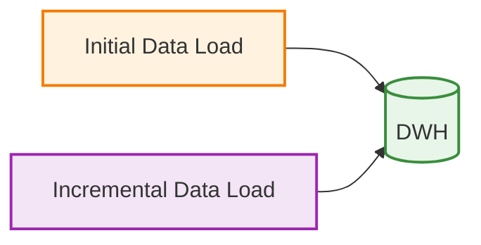
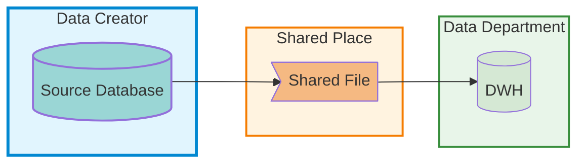
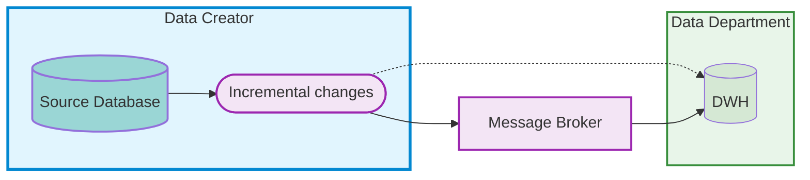
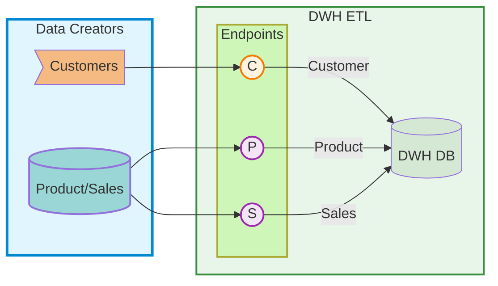
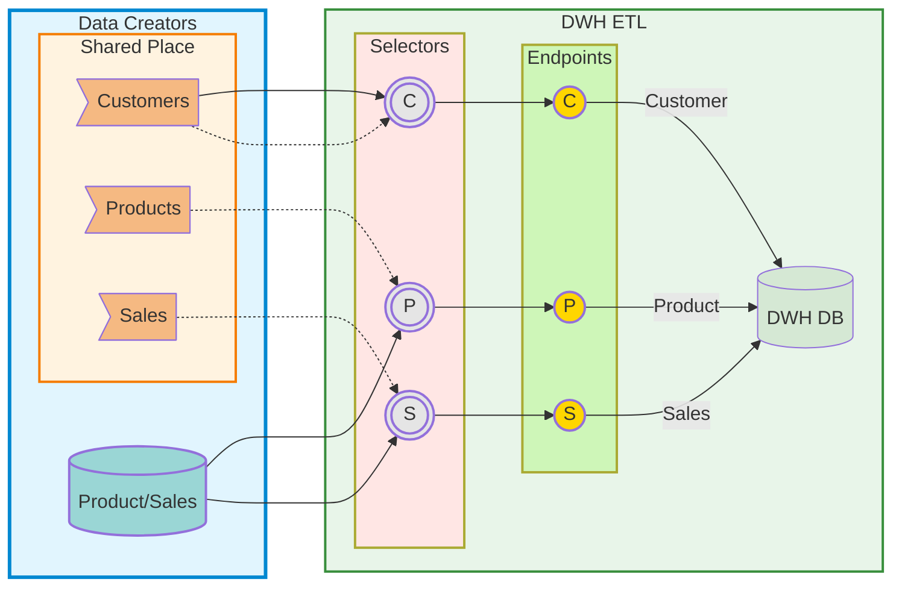
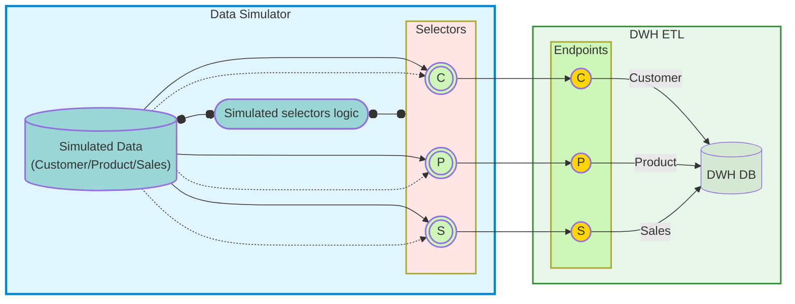
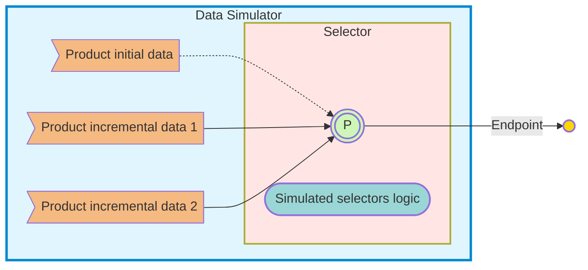
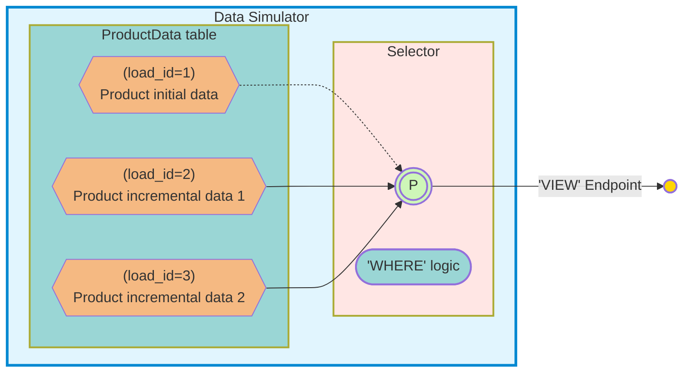
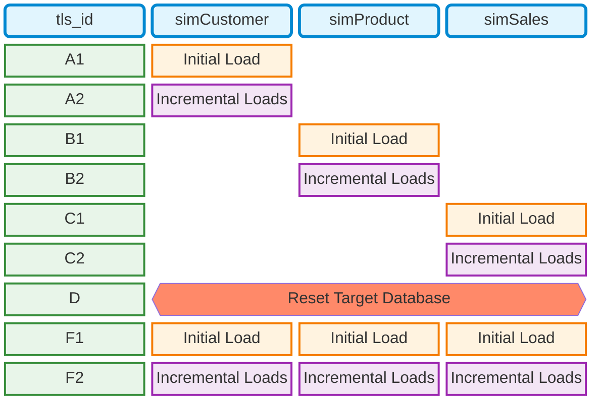

# Starting Small

<p align="right">
<i>"A problem well stated is a problem half solved."</i>
<br>- Charles Kettering
</p>

## How Much Data Do We Need?

Earlier, we examined a small but fairly substantial dataset. It's substantial in the sense that visually verifying even 177 products is a tedious task.

When debugging data pipeline logic, less than two dozen elements is more than enough, and the fewer the better. However, we shouldn't go too far in reducing data at the expense of functionality testing.

Let's consider how much data might be required using the "Customer" dimension as an example.

This dimension is implemented as a Slowly Changing Dimension Type 1 (SCD 1): it doesn't store history but simply overwrites attributes, keeping only their current state. And we need to verify several things:

* That data loads as such. For the most basic check, one record is enough.
* That if there are multiple records for a single customer, the most recent one by modification date is selected.

So minimally, we need three records: one for the general check and a second for verifying the selection of the most recent record within a group with a single key. In practice, it's better to have an additional pair of records for the second check, so we can verify that in a dataset with multiple groups, the algorithm can identify groups and select the most recent record from each group.

In total, we'll need a minimum of five customer records across three unique customers.

## Data Pipelines

The original DWH from which the data was taken is designed only for a single full load. This mode is typical for data analysts' approach. However, in real-world data pipelines for organizational DWHs, updated data is loaded continuously, and the requirements for organizing fault-tolerant pipelines are different. In general, two main modes are typically implemented:



In the first mode of initial load, the DWH, which at that moment contains no data, is populated with available data. The initial load is performed once.

In the second mode, data is loaded as it changes in the sources.

In a specific case, the data source can be the same for both modes: for example, we have a `csv` file with data that is stored in some shared location and is updated over time. For instance, some records in it may be updated, while new ones are added. Schematically, this can be represented as follows:



On one side, there is a data creator who updates the file over time. On the other side, there is a data department with a DWH that needs to account for changes in the warehouse. This is exactly the variant with a file in a shared location that we will consider for the "Customer" dimension.

However, much more often data updates are built according to a different scheme:



Here, only those changes that occurred over a certain period of time fall into the incremental changes.

These changes reach the DWH either directly upon its request or through an intermediary in the form of a message broker, which buffers and stores data, coordinating the mutual work.

We will use the incremental load variant for updates for the "Product" dimension and for the "Sales" fact.

Thus, our DWH, unlike the original one, will support a hybrid architecture for continuously receiving updated data from sources. This is precisely why we reduced the number of tables to three and removed extra elements for the "snowflake" schema to simplify the elements for implementing more complex data pipeline logic.

Let's draw another diagram:



Here we have indicated that customer data comes from a file, while product and sales data is taken from a database.

We have also designated the entry points for this data for each object as `Endpoints`.

This abstraction of the input layer will allow us to simplify the task of combining initial and incremental loads: if the data format remains the same for both cases, then we only need to switch the sources:



The selectors simply switch data flows, leaving their content as is. The solid line represents the data flow for incremental load, while the dashed line shows the data flows for initial load. This gives us the ability to switch between initial and incremental loads without changing the processing algorithms. These are exactly the algorithms we are going to implement and debug.

Small data is needed for debugging the logic functionality, as it allows us to verify the work visually.


## Data Simulator

To be able to work with small datasets, let's modify the diagram above and slightly rearrange the functional blocks:



The Data Simulator contains selectors and controls their logic. It also provides data to the input endpoints and allows simulating both initial and incremental loads.

The simulator will help us debug the pipeline algorithms by providing small datasets for convenient visual debugging.

But to understand how to implement it, we first need to consider what data we need to simulate and how.


### Data Simulation

The data loading process into DWH, as mentioned above, can be described with the following diagram:

```mermaid
flowchart LR
    IS@{ shape: filled-circle, label: "" }
    ES@{ shape: filled-circle, label: "" } 
    Init(("Initial\nLoad"))
    Inc_1["Incremental\nLoad 1"]
    Inc_2["Incremental\nLoad 2"]
    Inc_e["..."]   
    Inc_N["Incremental\nLoad N"]
    IS ---> Init
    Init--> Inc_1
    Inc_1 --> Inc_2 
    Inc_2 --> Inc_e
    Inc_e --> Inc_N
    Inc_N ---> ES

classDef cGreen fill:#d5e8d4;
classDef cBrown fill:#f5b982;
classDef cGreyBlue fill:#9ad6d5,stroke-width:2px
classDef cRose fill:#ffe6e4,stroke-width:2px
classDef clGreen fill:#cef6b8,stroke-width:2px
classDef cGrey fill:#E5E5E5,stroke-width:2px
classDef cGreyYellow fill:#FFD600,stroke-width:2px

classDef lightBlue fill:#e1f5fe,stroke:#0288d1,stroke-width:3px
classDef lightYellow fill:#fff3e0,stroke:#f57c00,stroke-width:2px
classDef lightGreen fill:#e8f5e9,stroke:#388e3c,stroke-width:2px
classDef lightViolet fill:#f3e5f5,stroke:#9c27b0,stroke-width:2px

class Init lightYellow
class Inc_1,Inc_2,Inc_e,Inc_N lightViolet
class IS,ES lightGreen
```



* First, there is an initial load, which is performed once.
* Then, multiple incremental loads follow, which update data changes.

In general, the Data Manipulation Language (DML) provides three operations:

* `INSERT` - inserting new data that is not present in the DWH.
* `UPDATE` - updating data that already exists in the DWH.
* `DELETE` - deleting data from the DWH.

The last operation, namely `DELETE`, is often not applied directly to the DWH used for analytics, as historical data is also of interest for analysis. We will not consider this operation in the context of our DWH, but note that to keep data in the database and have the ability to determine whether the data is current or not, an additional flag can be introduced for each record. This flag can be used to determine if the data has been deleted. Such a flag implements "soft" deletion, marking records as deleted without physically removing them.

The remaining two operations are often referred to by a single word: `UPSERT`. In the case of incremental loading of changing data, `UPSERT` is used specifically. During the initial load, when there is no data in the database yet, using `INSERT` will be much faster, but `UPSERT` will also correctly load the data.

Thus, test data in general should work with the `UPSERT` operation. This will be the same data format as for the import in the previous part from a `csv` file, and if there are already rows with the same key in the table, the new data should update them.

If parts of the test data are equivalent to files, then they can be placed in files and selected as needed, for example for a product:



However, with a dozen test scenarios and three tables, the number of files would amount to three dozen, and managing them would be difficult, as would checking what changed in the data from one test scenario to another.

It is much more convenient to place all of this in a table with an additional field for the test scenario number, organize the output point as a `VIEW`, and implement the selection logic as a `WHERE` condition:



Then, with a condition like `WHERE id = 1`, the view will return data for the initial load, and with `WHERE id = 2` it will return data for the first incremental load.

To control data portions for multiple sources at once, a separate table `simTestLoadScenario` can be organized with the following columns:

| field                | description                            |
| -------------------- | -------------------------------------- |
| tls_id               | scenario sequence number               |
| tls_name             | scenario name                          |
| tls_description      | scenario description                   |
| tls_Customer_load_id | load part number for customers         |
| tls_Product_load_id  | load part number for products          |
| tls_Sales_load_id    | load part number for sales             |

By specifying `load_id` for different sources, you can combine different loads in a scenario. The initial load is considered `load_id = 1`. With `load_id = 0`, nothing will be loaded for a specific source, as such a part will be absent from the data table.

To select the current scenario, a second table `simCurrentLoadScenario` can be created with a strict constraint that it can only contain one row:

```SQL
CREATE TABLE simCurrentLoadScenario (
  cls_id INTEGER PRIMARY KEY CHECK(cls_id = 1),
  tls_id INTEGER 
);

INSERT INTO simCurrentLoadScenario (cls_id, tls_id) VALUES (1,0);
```

Then, by updating the `tls_id` field in this table, you can switch scenarios, and the views for sources will look like this:

```SQL
CREATE VIEW simProduct
AS
SELECT 
  pd.prd_id,
  pd.prd_key,
  pd.prd_nm,
  pd.prd_cost,
  pd.prd_start_dt,
  pd.prd_end_dt
FROM productData AS pd
INNER JOIN simTestLoadScenario AS tls
  ON tls.tls_Product_load_id = pd.load_id
INNER JOIN simCurrentLoadScenario AS cls
  ON cls.tls_id = tls.tls_id;
```

Similarly, views are created for other data, where the `load_id` field needs to be added to select a particular load portion.

This will allow us to switch scenarios and data for loading with a simple query like: `UPDATE CurrentLoadScenario SET tls_id = 2`. The `sim` prefix is added to all objects to group them by functional attribute, as SQLite does not support schemas.

Now that we have determined the implementation of the data simulator, we can create a basic set of scenarios for testing:



First, we test the "Customer" dimension. First the initial load, and then one or two incremental loads. The other dimensions and facts do not return any data from the sources at this point. Next, we test the "Product" dimension in a similar way. After both dimensions have been tested and loaded, we test the "Sales" fact.

After completing the detailed testing by objects, we clear the target database and re-test the initial and incremental loads with data present in all sources to verify the integrity of such a load.

For the `tls_id` field, not numbers are specified, but some sequentially ordered labels, as each object needs to be considered using an example of what data can be created for it.

Let's consider this in detail.


### The "Customer" Dimension (the `customerData` table)

As we determined above, this dimension will behave as if it resided in an external file that is periodically updated according to the assumed model, where a separate department is responsible for this. Therefore, its data arrives in full, and the incremental load is effectively a complete reload on top of the existing data, which must be able to detect changes and apply them on its own. This dimension is also a Slowly Changing Dimension Type 1 (SCD 1) and does not preserve history: a new version overwrites the attributes by key.

If we look at the data from the previous part, we will see that the table contains a total of 18,483 records (including duplicates by key), and the business key falls within the range `AW00011000` - `AW00029483`. The surrogate key corresponds to the number in the business key and has a value range of `11000` - `29483`.

Let's create five rows of data for the initial load for this table, using numbers starting from `1001` with the prefix `TV`, which stands for `Test Valid`, that is, valid test data. For the first and last names, we will also choose values that start with `T` for the last name and `V` for the first name in all records, so that there are no matching first and last names in the original data. We will take dates within January 2025.

| cst_id | cst_key    | cst_firstname | cst_lastname | cst_create_date | load_id | notes                          |
| -----: | :--------- | :------------ | :----------- | :-------------- | :-----: | :----------------------------- |
|   1001 | TV00001001 | Verity        | Terry        | 2025-01-01      |    1    | simple single record           |
|   1002 | TV00001002 | *NULL*        | *NULL*       | 2025-01-01      |    1    | first pair of duplicates by key |
|   1002 | TV00001002 | Vivian        | Turner       | 2025-01-02      |    1    | first pair of duplicates by key |
|   1003 | TV00001003 | *NULL*        | Tucker       | 2025-01-04      |    1    | second pair of duplicates by key |
|   1003 | TV00001003 | V             | Tucker       | 2025-01-05      |    1    | second pair of duplicates by key |

From this data, the following should remain as the final result:
* the first row with `id=1001`
* the third row with `id=1002` and the date `2025-01-02`
* the fifth row with `id=1003` and the date `2025-01-05`

For the next load, we are going to make the following changes:
* remove row 4 with the date `2025-01-04`
* add the next refinement for customer `1003` and set their full first name to "Vishal"
* add one more customer
* at the same time, the rest of the data must remain, since we are reloading the data

How can this be implemented? This can be done using bitmasks and the bitwise AND operation. For example, load blocks can be implemented as follows:

| Block number | Block bitmask (value) | Load bitmask (value) | Load by mask            |
| ------------ | --------------------- | -------------------- | ----------------------- |
| 1            | 001(1)                | 001(1)               | will load block 1       |
| 2            | 010(2)                | 011(3)               | will load blocks 1 and 2 |
| 3            | 100(4)                | 111(7)               | will load blocks 1, 2 and 3 |

In the bitmask, the binary `1` shifts from block to block from right to left: in the first block it is in the least significant bit, in the second - in the middle bit, and in the third - in the most significant bit. Then, if we apply the mask `011`, both the first and the second blocks will be included, and with the mask `111` - all three blocks.

Indeed: `011 & 001 = 001 > 0` and `011 & 010 = 010 > 0`.

If we need a block to be loaded only for one specific load, we can introduce an additional field `for_mask` and specify in it a value for an exact comparison operation with the mask, when the value of this field is not zero:

| row | load_id | for_mask |
| --- | ------- | -------- |
| 1   | 1       | 0        |
| 2   | 1       | 1        |
| 3   | 2       | 0        |
| 4   | 2       | 3        |
| 5   | 4       | 0        |

Then, when loading the first block, where the mask value used is 1, rows 1 and 2 will be loaded.

When loading the second block, where the mask value is 3, rows 1, 3, and 4 will be loaded. The second row will not be loaded, since 1 is not equal to 3, while the fourth row is loaded, since 3 equals 3.

When loading the third block, the fourth row will be skipped, since 3 is not equal to 7. The second row will also be skipped, and rows 1, 3, and 5 will be loaded.

The complete condition for both fields is: `(load_id & mask) > 0 AND (for_mask = 0 OR for_mask = mask)`.

Now we can extend the scenario for the second load:

| cst_id | cst_key    | cst_firstname | cst_lastname | cst_create_date | load_id | for_mask | notes                           |
| -----: | :--------- | :------------ | :----------- | :-------------- | :-----: | :------: | :------------------------------ |
|   1001 | TV00001001 | Verity        | Terry        | 2025-01-01      |    1    |    0     | simple single record            |
|   1002 | TV00001002 | *NULL*        | *NULL*       | 2025-01-01      |    1    |    0     | first pair of duplicates by key |
|   1002 | TV00001002 | Vivian        | Turner       | 2025-01-02      |    1    |    0     | first pair of duplicates by key |
|   1003 | TV00001003 | *NULL*        | Tucker       | 2025-01-04      |    1    |    1     | removed in the second load      |
|   1003 | TV00001003 | V             | Tucker       | 2025-01-05      |    1    |    0     | second pair of duplicates by key |
|   1003 | TV00001003 | Vishal        | Tucker       | 2025-01-13      |    2    |    0     | second load update              |
|   1004 | TV00001004 | V             | T            | 2025-01-14      |    2    |    0     | new record of the second load   |

The data we will obtain in the second load will look like this:

| cst_id | cst_key    | cst_firstname | cst_lastname | cst_create_date |
| -----: | :--------- | :------------ | :----------- | :-------------- |
|   1001 | TV00001001 | Verity        | Terry        | 2025-01-01      |
|   1002 | TV00001002 | *NULL*        | *NULL*       | 2025-01-01      |
|   1002 | TV00001002 | Vivian        | Turner       | 2025-01-02      |
|   1003 | TV00001003 | V             | Tucker       | 2025-01-05      |
|   1003 | TV00001003 | Vishal        | Tucker       | 2025-01-13      |
|   1004 | TV00001004 | V             | T            | 2025-01-14      |

That is, customer `1003` with the date `2025-01-04` will be absent from it.

In the third load, we will additionally update customer `1004`:

| cst_id | cst_key    | cst_firstname | cst_lastname | cst_create_date | load_id | for_mask | notes                                    |
| -----: | :--------- | :------------ | :----------- | :-------------- | :-----: | :------: | :--------------------------------------- |
|   1001 | TV00001001 | Verity        | Terry        | 2025-01-01      |    1    |    0     | simple single record                     |
|   1002 | TV00001002 | *NULL*        | *NULL*       | 2025-01-01      |    1    |    0     | first pair of duplicates by key          |
|   1002 | TV00001002 | Vivian        | Turner       | 2025-01-02      |    1    |    0     | first pair of duplicates by key          |
|   1003 | TV00001003 | *NULL*        | Tucker       | 2025-01-04      |    1    |    1     | removed in the second and third loads    |
|   1003 | TV00001003 | V             | Tucker       | 2025-01-05      |    1    |    0     | second pair of duplicates by key         |
|   1003 | TV00001003 | Vishal        | Tucker       | 2025-01-13      |    2    |    0     | second load update                       |
|   1004 | TV00001004 | V             | T            | 2025-01-14      |    2    |    0     | new record of the second load            |
|   1004 | TV00001004 | Vivek         | T            | 2025-02-15      |    4    |    0     | third load update                        |
|   1004 | TV00001004 | Vivek         | Tripp        | 2025-02-16      |    4    |    0     | third load update                        |

This is the complete content of the table for all three loads.

In the `simTestLoadScenario` table, the `tls_Customer_load_id` field will use exactly the load bitmask:

| tls_id | tls_name | tls_description                        | tls_Customer_load_id | tls_Product_load_id | tls_Sales_load_id |
| ------ | -------- | -------------------------------------- | -------------------- | ------------------- | ----------------- |
| 1      | C-VT01   | Customer valid test initial load       | 1                    | 0                   | 0                 |
| 2      | C-VT02   | Customer valid test incremental load 1 | 3                    | 0                   | 0                 |
| 3      | C-VT03   | Customer valid test incremental load 2 | 7                    | 0                   | 0                 |


### The "Product" Dimension (the `productData` table)

The surrogate key values in the product table start from `212`. We will use values starting from `101`. The product code is formed from the brand name, product type, some digits, and symbols indicating the size.

Let's come up with three brands: "SporticsDog", "Mike and Cat", and "JJ Run", and name the product "Track Vest" (using the prefix `TV` based on the first letters).

Then, for the first load, we will create one product with a closed validity interval, a second one - with an open interval, and a product with two intervals:

| prd_id | prd_key    | prd_nm                      | prd_cost | prd_start_dt | prd_end_dt | load_id |
| -----: | :--------- | :-------------------------- | -------: | :----------- | :--------- | :-----: |
|    101 | TV-SD10-L  | Track Vest SporticsDog - L  |       10 | 2025-01-01   | 2025-03-01 |    1    |
|    102 | TV-MC70-S  | Track Vest Mike and Cat - S |        5 | 2025-01-02   | *NULL*     |    1    |
|    103 | TV-JJ17-XS | Track Vest JJ Run - XS      |        7 | 2025-01-03   | 2025-02-05 |    1    |
|    104 | TV-JJ17-XS | Track Vest JJ Run - XS      |        9 | 2025-02-05   | *NULL*     |    1    |

In the product dimension, changes are incremental, so bitmasks are not required for incremental loads. For the first incremental load, we will make the following changes:

* Add a new validity interval for the product `TV-MC70-S`.
* Add one more product.

| prd_id | prd_key    | prd_nm                      | prd_cost | prd_start_dt | prd_end_dt | load_id |
| -----: | :--------- | :-------------------------- | -------: | :----------- | :--------- | :-----: |
|    102 | TV-MC70-S  | Track Vest Mike and Cat - S |        5 | 2025-01-02   | 2025-02-05 |    2    |
|    105 | TV-MC70-S  | Track Vest Mike and Cat - S |        7 | 2025-02-05   | *NULL*     |    2    |
|    106 | TV-JJ17-XL | Track Vest JJ Run - XL      |        8 | 2025-02-03   | *NULL*     |    2    |

As we can see, to close the previous interval, we use the existing surrogate key `102`, setting a new end date for it, and for the next interval, we use a new surrogate key `105`. For a completely new row, we use the next sequential surrogate key `106`.

In the second incremental load, we will update the intervals for two products:

* open a new interval for `TV-JJ17-XS`.
* close the interval for `TV-JJ17-XL`.

| prd_id | prd_key    | prd_nm                 | prd_cost | prd_start_dt | prd_end_dt | load_id |
| -----: | :--------- | :--------------------- | -------: | :----------- | :--------- | :-----: |
|    104 | TV-JJ17-XS | Track Vest JJ Run - XS |        9 | 2025-02-05   | 2025-03-03 |    3    |
|    107 | TV-JJ17-XS | Track Vest JJ Run - XS |       11 | 2025-03-03   | *NULL*     |    3    |
|    106 | TV-JJ17-XL | Track Vest JJ Run - XL |        8 | 2025-02-03   | 2025-04-03 |    3    |

Overall, this dataset is quite sufficient to test this dimension.


### The "Sales" Fact Table (the `salesData` table)

The business key of an order in this table starts with `SO` (`Sales Order`) and falls within the range `SO43697` - `SO75123`.
We will use the prefix `TVSO` and start from `101`, for example, `TVSO101`.

This table is the simplest in terms of loading, since data is only appended to it. It is only necessary to take the product validity interval into account. For the customer identifier, we can use just a few values covering both records without duplicates and records with duplicates.

For the initial load, we will take two orders, each containing two products, from two customers:

| sls_ord_num | sls_prd_key | sls_cust_id | sls_order_dt | sls_ship_dt | sls_due_dt | sls_sales | sls_quantity | sls_price | load_id |
| :---------- | :---------- | ----------: | :----------: | :---------: | :--------: | --------: | -----------: | --------: | :------ |
| TVSO101     | TV-SD10-L   |        1001 |   20250104   |  20250106   |  20250109  |        10 |            1 |        10 | 1       |
| TVSO101     | TV-JJ17-XS  |        1001 |   20250104   |  20250106   |  20250109  |        14 |            2 |         7 | 1       |
| TVSO102     | TV-SD10-L   |        1002 |   20250105   |  20250109   |  20250111  |        10 |            1 |        10 | 1       |
| TVSO102     | TV-MC70-S   |        1002 |   20250105   |  20250109   |  20250111  |         5 |            1 |         5 | 1       |

For the first incremental load, we will add orders for products whose prices changed in February, for the same customers:

| sls_ord_num | sls_prd_key | sls_cust_id | sls_order_dt | sls_ship_dt | sls_due_dt | sls_sales | sls_quantity | sls_price | load_id |
| :---------- | :---------- | ----------: | :----------: | :---------: | :--------: | --------: | -----------: | --------: | :------ |
| TVSO103     | TV-JJ17-XL  |        1001 |   20250206   |  20250208   |  20250209  |         8 |            1 |         8 | 2       |
| TVSO103     | TV-MC70-S   |        1001 |   20250206   |  20250208   |  20250209  |        14 |            2 |         7 | 2       |
| TVSO104     | TV-JJ17-XL  |        1002 |   20250207   |  20250209   |  20250211  |         9 |            1 |         9 | 2       |
| TVSO104     | TV-MC70-S   |        1002 |   20250207   |  20250209   |  20250211  |         7 |            1 |         7 | 2       |

For the second incremental load, we will take products updated in March and use a couple of other customers:

| sls_ord_num | sls_prd_key | sls_cust_id | sls_order_dt | sls_ship_dt | sls_due_dt | sls_sales | sls_quantity | sls_price | load_id |
| :---------- | :---------- | ----------: | :----------: | :---------: | :--------: | --------: | -----------: | --------: | :------ |
| TVSO105     | TV-JJ17-XL  |        1003 |   20250306   |  20250308   |  20250309  |         8 |            1 |         8 | 3       |
| TVSO105     | TV-JJ17-XS  |        1003 |   20250306   |  20250308   |  20250309  |        22 |            2 |        11 | 3       |
| TVSO106     | TV-JJ17-XL  |        1004 |   20250307   |  20250309   |  20250311  |        16 |            2 |         8 | 3       |
| TVSO106     | TV-JJ17-XS  |        1004 |   20250307   |  20250309   |  20250311  |        11 |            1 |        11 | 3       |


### All Data Together

A small dataset is convenient because it allows for easy visual verification of data integrity: it can fit on a single spreadsheet page.


As clearly shown in the image, it is easy to highlight logically related cells with different colors and verify the correctness of the dataset. Additionally, three dates are highlighted in different colors (green, purple, blue) following the `ETL loads` marker.
These dates represent simulated ETL load dates:

* During the first (initial) load, data up to `2025-01-08` is added (highlighted in green).
* During the second (first incremental) load, data with dates `2025-01-09` - `2025-02-08` is added (highlighted in purple).
* During the third (second incremental) load, data with dates `2025-02-09` - `2025-03-08` is added (highlighted in blue).

In this case, the sales dates follow the load dates for both the product and the customer. The dates are chosen purely for visual clarity, with a one-month interval.

The complete `simTestLoadScenario` table looks like this:

| tls_id | tls_name | tls_description                        | tls_Customer_load_id | tls_Product_load_id | tls_Sales_load_id |
| ------ | -------- | -------------------------------------- | -------------------- | ------------------- | ----------------- |
| 1      | C-VT01   | Customer valid test initial load       | 1                    | 0                   | 0                 |
| 2      | C-VT02   | Customer valid test incremental load 1 | 3                    | 0                   | 0                 |
| 3      | C-VT03   | Customer valid test incremental load 2 | 7                    | 0                   | 0                 |
| 4      | P-VT01   | Product valid test initial load        | 0                    | 1                   | 0                 |
| 5      | P-VT02   | Product valid test incremental load 1  | 0                    | 2                   | 0                 |
| 6      | P-VT03   | Product valid test incremental load 2  | 0                    | 3                   | 0                 |
| 7      | S-VT01   | Sales valid test initial load          | 0                    | 0                   | 1                 |
| 8      | S-VT02   | Sales valid test incremental load 1    | 0                    | 0                   | 2                 |
| 9      | S-VT03   | Sales valid test incremental load 2    | 0                    | 0                   | 3                 |
| 10     | CLR      | Clear loaded data                      | 0                    | 0                   | 0                 |
| 11     | A-VT01   | All data valid test initial load       | 1                    | 1                   | 1                 |
| 12     | A-VT02   | All data valid test incremental load 1 | 3                    | 2                   | 2                 |
| 13     | A-VT03   | All data valid test incremental load 2 | 7                    | 3                   | 3                 |

Identifier `10` is reserved for clearing the loaded data between detailed single-table loads and simultaneous all-table loads, allowing the process to be restarted from the initial load.

## Conclusions

We have explored the process of creating small test datasets and a data simulator. The simulator allows us to simulate both initial and incremental loads. Such simulation is possible if the data formats for the initial and incremental loads are identical. A small dataset allows for visual verification of data correctness during loading and is highly convenient for implementing and debugging data pipeline logic in real-world DWHs. For this type of debugging, SQLite is perfectly sufficient. The data cleaned in the previous article will be used later to test the fully built pipeline.

## References

* Source code for this article: [DWH Step By Step Part 2](https://github.com/dyacc11/DWH_StepByStep/Part_02)
- **[Part 1: Data Correction and Generation](https://github.com/dyacc11/DWH_StepByStep/Part_01)**
