# A Simple Data Pipeline

<p align="right">
<i>"Done is better than perfect".</i>
<br>- Sheryl Sandberg
</p>

## Which architecture to choose?

If you ask data engineers today which architecture to choose for a pipeline that loads data into a DWH, most would likely suggest the medallion architecture:


This architecture is easy to remember thanks to a clear analogy with Olympic medals: from bronze (third place) to gold (first place). This matches the ranking of data quality from low to high and is familiar to almost everyone.

However, if we look a bit into history, this architecture appeared relatively recently: in 2019 it was introduced in the article "Productionizing Machine Learning with Delta Lake", written by Brenner Heintz and Denny Lee from Databricks.

A bit earlier, at Spark Summit Europe 2017, Databricks presented their product Delta Lake. The medallion architecture from the 2019 article was meant to promote Delta Lake specifically as the primary storage for the bronze layer, and Spark as the means of implementing pipelines.

It's important to understand that Delta Lake is an add-on layer on top of a data lake: the data itself sits in plain files, and Delta Lake lets you work with it as if it were tables. So this whole architecture is not really about traditional DWHs built on database servers.

In fact, there can be several ways to obtain data suitable for business analytics, for example, with a final "star" schema according to Kimball, while producing exactly the same result:

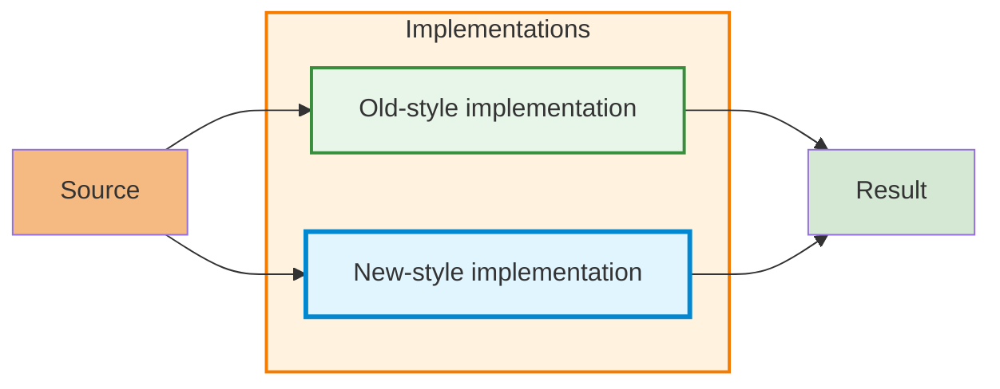

### A Bit of History

In the era of classical DWHs implemented on database servers, there was no such concept as a "pipeline".
If you open Kimball's classic book "The Data Warehouse ETL Toolkit", you won't find this word there. You also won't find it in the book "Professional SQL Server 2000 Data Warehousing with Analysis Services", one of the authors of which was Denny Lee, the very same person who introduced the medallion architecture to the world together with Brenner Heintz.

In those days, it was called "ETL" after the names of its constituent stages: "Extract-Transform-Load".
Often, ETL transferred data from a source database for online transaction processing to a DWH in the following way:

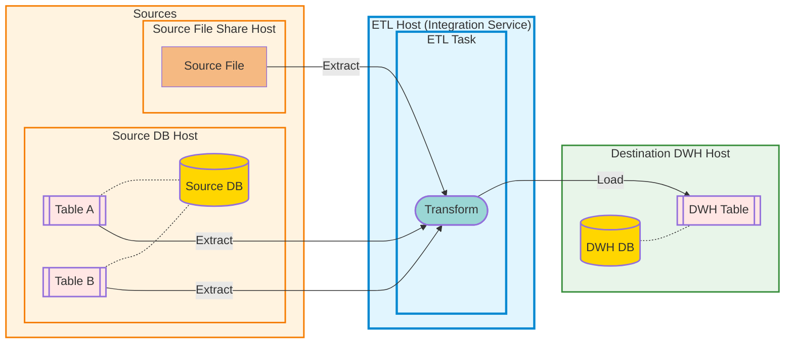

Suppose our data sources include a database with tables "Table A" and "Table B" on the "Source DB Host" node, as well as a file "Source File" in network storage on the "Source File Share Host" node. The integration service, located on the "ETL Host" node, executes the ETL task "ETL Task". This task first extracts data from the sources (Extract), then consolidates and transforms it (Transform), and finally loads (Load) it into the target table "DWH Table" of the database "DWH DB", located on a separate node "Destination DWH Host". Hence the name ETL.

However, this implementation has performance issues, as complex data transformation on the integration service side works slowly. For example, if you need to join tables "Table A" and "Table B", and they are so large that they don't fit into memory simultaneously, the integration service would have to temporarily store (cache) all input data on its side to perform this operation.

To speed up the ETL process, it was implemented slightly differently:

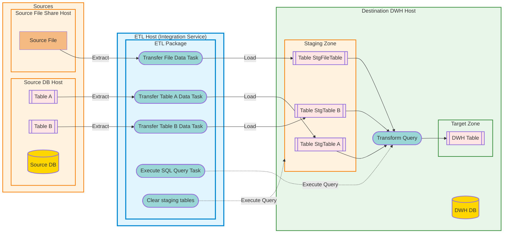

With this approach, on the target DWH database side, a special intermediate zone called `Staging` was created, where several intermediate tables were placed: `StgTable A`, `StgTable B`, `StgFileTable`.

Then several tasks (Transfer Table A Data Task, Transfer Table B Data Task, Transfer File Data Task), which were usually called "data pump tasks", transferred data from the sources into these tables, while on the target side a bulk insert was performed, which is a fast operation.

After that, the integration service executed a SQL transformation query to join the data from the sources already in the `Staging` zone, which also worked faster than transformation on the integration service side, thanks to much better optimization on the database server side and the ability to use indexes. Upon completion of the transfer, the ETL process cleared the intermediate tables in the `Staging` zone with a fast query like `TRUNCATE TABLE` for subsequent loading of a new batch of data on the next run.

Formally, such a process should already be called ELT, since the operations go in a somewhat different order. But even this approach was still called ETL.

The terminology began to change when Big Data emerged, and Hadoop and data lakes started their rise to prominence.
With their arrival, data processing changed, as clearly shown in the following diagram:

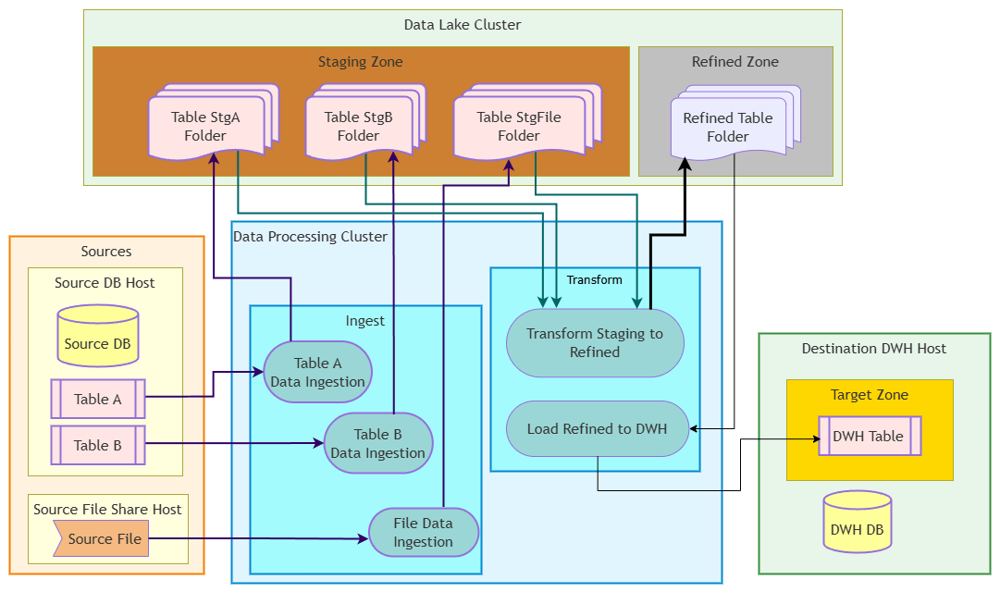

Data lakes provided cheap storage for large volumes of information on distributed file systems, meaning data in the intermediate area no longer had to be deleted, but could be accumulated. Data lakes also enabled massively parallel processing on a dedicated compute cluster.

The methodology also changed: the cluster would now pull data from sources and move it into the data lake, where it was stored not in tables, but in directories as files. This process became known no longer as Extract, but as Data Ingestion.

The ingested data is stored in the `Staging` zone, a name retained here by analogy with the classic ETL process for DWHs, although the process itself is now effectively an ELT process. Next, the cluster pulls data from the `Staging` zone and transforms it, placing it into the cleaned `Refined` zone, which can reside in the same data lake. Then, the cleaned data moves into the DWH database, into the `Target` zone, where analytical SQL queries can be executed against it. In a classic DWH, there was no separate zone for cleaned data, as the target table itself fulfilled this role. If these zones are color-coded, they can be mapped to the "bronze", "silver", and "gold" layers of the medallion architecture.

A similar process could be executed in a classic DWH using an ELT approach instead of classic ETL, but with two caveats in mind:

* Storing a large history in `Staging` on the database side is expensive. Not all companies can afford this, especially when using IaaS cloud infrastructure.
* Classic relational DBMSs scale only vertically, meaning by increasing the power of the machine they are hosted on. Massively Parallel Processing (MPP) databases, such as Teradata, are also not easy to load with large volumes of data.

In terms of data storage volumes, the distribution across zones looks approximately like this:

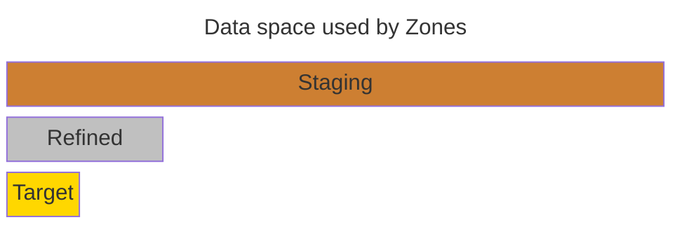

The largest portion of data resides in the intermediate `Staging` zone, which stores history. 
There is much less data in the cleaned `Refined` zone, as it reflects the current state of information from source systems and may contain master reference data (dictionaries) for matching records from different sources. 
And very little data is found in the `Target` zone, which presents the information as a ready-to-use product for business analytics.

Processing in data lakes differs significantly from processing on an integration service. Now the input data stream must be split into segments, distributing it across multiple files to enable parallel processing on compute cluster nodes when moving between processing zones. Such big data processing is no longer performed by simple data transfer tasks or SQL queries, but by more complex algorithms using the MapReduce approach to distribute computation across nodes, which became widely adopted with the emergence of Hadoop. The schemes of such processing no longer fit into the term ETL, and both developers and authors of Hadoop guides began proposing new names for them.

For example, such a scheme can be called a pipe assembly:

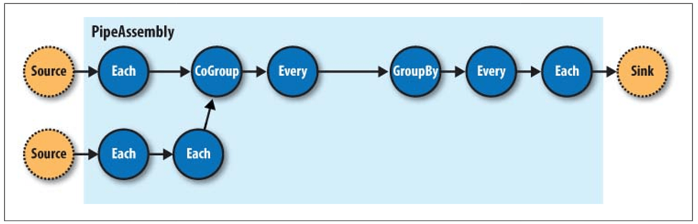
*PipeAssembly from the Hadoop Pipes API (Tom White, "Hadoop: The Definitive Guide")*

And indeed, this resembles the schemes used, say, by plumbers or hydraulic engineers:

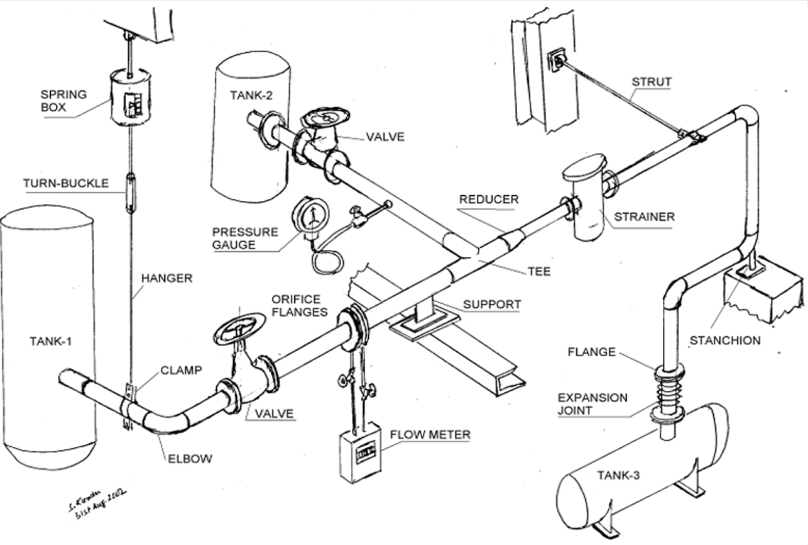

But ultimately, since data is split into parts, processed, and then reassembled, the community arrived at the universal term "data pipeline", which is used today.

It is clear that designing and implementing such a pipeline requires a highly skilled engineer. For this kind of task, a full-stack developer (e.g., in Java) is often a better fit than a DBA or a database specialist, because the programming is done at a lower level than SQL, and the data processing cluster tools themselves are written in Java or Scala.

The need for a tool that would allow writing pipelines in SQL (the standard for relational databases) and lower the qualification requirements for engineers led to the creation of an intermediate layer between data lakes and high-level queries. This led to the emergence of the Lakehouse:

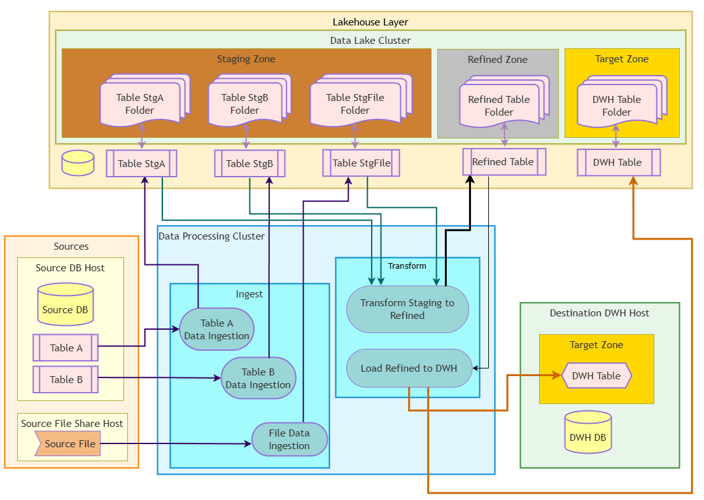

A Lakehouse adds the ability to work with data using SQL, while the data itself remains stored in the data lake.

In essence, if we don't dive into the technical details and limitations, it acts as a relational database engine built on top of a data lake. This provides another significant advantage over a plain data lake: the final data in the `Target` zone can be stored directly in the Lakehouse! Does this mean that in such a DWH, you can do without a classic relational database engine altogether? The answer is: yes and no. If the final business data product is presented, say, as a wide table and does not require joins with other tables, then the capabilities of a Lakehouse are more than enough, and an additional relational database is not needed. However, if the analytical queries are complex and involve joining multiple tables with various conditions, classic relational database systems handle this much better, thanks to their advanced optimization and indexing capabilities.

The lakehouse was the very foundation upon which Databricks introduced the medallion architecture, using Delta Lake as a concrete implementation of the lakehouse concept. Moreover, for the machine learning (ML) use cases described in that article, even a classic relational database is not required: all data is stored directly in the lakehouse.

Now that we have reviewed the history of data processing, we can move on to choosing a specific solution.

### Prototyping

Obviously, a modern DWH designed to handle potentially large data volumes should be built using a lakehouse. However, at the very beginning of a project, when only a high-level solution sketch exists and, possibly, a preliminary object description, there is no point in immediately choosing the most complex pipeline architecture with a lakehouse and a compute cluster. First, you need to validate the concept by building a prototype or "sandbox". It makes sense to expand this prototype and change the storage implementation only after the core algorithms have been debugged.

Such a "sandbox" can easily be implemented locally, using SQLite as the foundation and GUI tools such as SQLiteStudio or DB Browser for SQLite. That is exactly what we will do, building a fully local DWH based on the data simulator described [here](https://github.com/dyacc11/DWH-StepByStep/tree/main/Part_02).

#### "Gold" Zone

Typically, analysis begins at the top "gold" layer to prioritize business requirements. In our case, we will skip the lengthy analysis process - it is sufficient for us to ultimately get two dimensions and a sales fact table to analyze them by customer and product. A separate calendar dimension is not included, although it is typically mandatory. It can be added later. The general schema of the final business layer can be represented as follows:

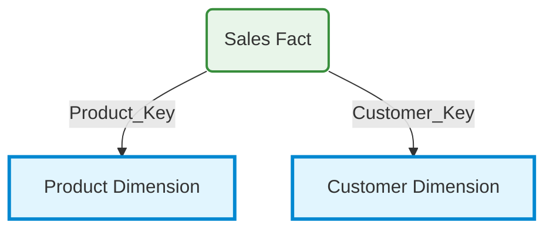

For this business analysis layer, we will use database views. The fact table is joined to the dimensions via the `Product_Key` and `Customer_Key` keys, respectively. These fields are absent in the source data. We will determine which specific fields will serve as these keys later.

First, let's list the fields that will be included in the final views and map them to the corresponding fields in the source data. For the source data, we will use the views from the data simulator: `simProduct`, `simCustomer`, `simSales`.

"Customer" Dimension:

| Customer Dimension Field    | Field in `simCustomer` | Description                                              |
| --------------------------- | ---------------------- | -------------------------------------------------------- |
| Customer_Key                | cst_id                 | We use a surrogate key for joining                       |
| Customer Code               | cst_key                | Customer business key from CRM                           |
| Customer First Name         | cst_firstname          | Customer's first name                                    |
| Customer Last Name          | cst_lastname           | Customer's last name                                     |
| Customer Last Modified Date | cst_create_date        | Date of creation/last modification of the customer record|

We select the customer surrogate key as the join key to the fact table, as it is unique for each customer. For the field names, we use natural, human-readable names for display in business analytics reports.

"Product" Dimension:

| Product Dimension Field      | Field in `simProduct` | Description                                                     |
| ---------------------------- | --------------------- | --------------------------------------------------------------- |
| Product_Key                  | prd_id                | We use a surrogate key for joining                              |
| Product Code                 | prd_key               | Product business key from ERP                                   |
| Product Name                 | prd_nm                | Product name                                                    |
| Product Cost                 | prd_cost              | Unit cost of the product                                        |
| Product Effective Start Date | prd_start_dt          | Effective start date of the product interval                    |
| Product Effective End Date   | prd_end_dt            | Effective end date of the product interval                      |
| Is Current Product           | -                     | This record is current as of today's date based on effective dates |

We select the product surrogate key as the join key to the fact table, as it is unique for each product within a single effective date range.

"Sales" Fact:

| Sales Fact Field          | Field in `simSales` | Description                                      |
| ------------------------- | ------------------- | ------------------------------------------------ |
| Product_Key               | -                   | We use a surrogate key for joining               |
| Customer_Key              | sls_cust_id         | We use a surrogate key for joining               |
| Sales Order Number        | sls_ord_num         | Order number from ERP                            |
| Sales Order Date          | sls_order_dt        | Order date                                       |
| Shipment Date             | sls_ship_dt         | Shipment date                                    |
| Delivery Due Date         | sls_due_dt          | Delivery due date                                |
| Product Sales (per Order) | sls_sales           | Sales amount for a specific product              |
| Item Quantity             | sls_quantity        | Quantity of a specific product in the order      |

Since the price is already in the "Product" dimension, there is no need to duplicate it in the "Sales" fact. Similarly, the product code, which serves as the business key, is omitted from the fact table because it is already available in the "Product" dimension.

Data in the "gold" zone views will be derived from the "silver" zone tables, which we will call "refined". We will define their schema a bit later.

The "gold" zone should not involve dynamic key computations, as, for example, is done [here](https://github.com/DataWithBaraa/sql-data-warehouse-project/blob/main/03_scripts/gold/ddl_gold.sql):

```sql
CREATE VIEW gold.dim_customers AS
SELECT
    ROW_NUMBER() OVER (ORDER BY cst_id) AS customer_key,    -- Surrogate key  !!! 
    ci.cst_id                           AS customer_id,
    ci.cst_key                          AS customer_number,
    ci.cst_firstname                    AS first_name,
    ci.cst_lastname                     AS last_name,
    la.cntry                            AS country,
    ci.cst_marital_status               AS marital_status,
    CASE
        WHEN ci.cst_gndr != 'n/a' THEN ci.cst_gndr -- CRM is the primary source for gender
        ELSE COALESCE(ca.gen, 'n/a')               -- Fallback to ERP data
    END                                 AS gender,
    ca.bdate                            AS birthdate,
    ci.cst_create_date                  AS create_date
```

As seen in the code, the surrogate key `customer_key` is computed dynamically at query execution time using the `ROW_NUMBER()` function. This has a critically negative impact on performance, as the query optimizer cannot use indexes to speed up execution, since this physical field does not exist in the underlying tables.

Next, we will build the "bronze" zone.

#### "Bronze" Zone

This zone stores a copy of the incoming data as it is loaded into the DWH, without any modifications. Although this leads to duplicated data storage, this approach allows us to create a "time machine" for debugging: we always know exactly what data arrived and at what moment. If inconsistencies or pipeline errors are later discovered in the data, we can retrospectively trace the path of this data to the "gold" zone and find the error. At the same time, this data may no longer exist in the source systems themselves, as it has changed multiple times since then, and retrieving the original data for a specific point in time might require a separate restoration of the source database from backups. Additionally, the "bronze" zone allows for a complete reload of subsequent zones without needing to connect to the data sources.

To store data retrospectively from the moment it is received from the sources, at least two fields must be added to the original data:

* Load timestamp
* Identification of the specific data source for the load

Since the data itself is not modified in any way, we will use the `raw` prefix for tables in this zone. For example, for the "Product" dimension, the table will look like this:

```SQL
CREATE TABLE rawProduct (
    prd_id           INTEGER,
    prd_key          TEXT,
    prd_nm           TEXT,
    prd_cost         INTEGER,
    prd_start_dt     TEXT,
    prd_end_dt       TEXT,
    
-- ** storing the history  **
    LOAD_TS_UTC      INTEGER,  -- load timestamp (UTC)
    RECORD_SOURCE    TEXT      -- source
);
```

To avoid confusion with time zones, it makes sense to record timestamps in a single time zone, for example, UTC. Hence the name of the `LOAD_TS_UTC` field. The `RECORD_SOURCE` field stores the source from which the data was taken.

Sometimes, the "bronze" zone is confused with the so-called "landing" zone. 
In this case, the table exactly matches the fields of the loaded file, but additional fields for tracking history and source are missing, as, for example, [here](https://github.com/DataWithBaraa/sql-data-warehouse-project/blob/main/03_scripts/bronze/ddl_bronze.sql):

```SQL
CREATE TABLE bronze.crm_cust_info (
    cst_id              INT,
    cst_key             NVARCHAR(50),
    cst_firstname       NVARCHAR(50),
    cst_lastname        NVARCHAR(50),
    cst_marital_status  NVARCHAR(50),
    cst_gndr            NVARCHAR(50),
    cst_create_date     DATE
);
```

The schema of such a table exactly mirrors the external `CSV` file. Many database engines support extended SQL syntax for directly loading a file into a table natively, as, for example, [here](https://github.com/DataWithBaraa/sql-data-warehouse-project/blob/main/03_scripts/bronze/proc_load_bronze.sql):

```SQL
 PRINT '>> Truncating Table: bronze.crm_cust_info';
   TRUNCATE TABLE bronze.crm_cust_info;
 PRINT '>> Inserting Data Into: bronze.crm_cust_info';
   BULK INSERT bronze.crm_cust_info
   FROM 'C:\sql\dwh_project\01_datasets\source_crm\cust_info.csv'
   WITH (
        FIRSTROW = 2,
        FIELDTERMINATOR = ',',
         TABLOCK
       );
```

First, the table is completely cleared, and then data is loaded into it from the file using the `BULK INSERT` command (the syntax may differ in other RDBMSs). Afterward, the data imported via extended SQL can be used in the subsequent processing pipeline directly on the database side.

In the medallion architecture, the `landing` zone is not considered part of the "bronze" zone, but rather an auxiliary technical zone that can be used to populate the "bronze" zone with data via a convenient SQL query from such a table.

If we build a DWH by extending the data simulator described earlier, the `landing` zone is not required, since the data is already in the database. The `LOAD_TS_UTC` field can be populated in at least two ways:

* By using a table that stores the pipeline execution history: a new record with the timestamp of the current run is inserted into it, and this exact value is then used during the data load.
* By using the built-in features of the execution environment. For example, dbt has a Jinja variable `{{ run_started_at }}` that stores the timestamp of the dbt run.

In our case, we can simply use the scenario number, that is, the `simCurrentLoadScenario.tls_id` field, as a placeholder timestamp, and later replace this prototype with a real timestamp using one of the above-mentioned methods.
Then, populating the `rawProduct` table looks like a simple `INSERT` query:

```SQL
INSERT INTO rawProduct
(
    prd_id,
    prd_key,
    prd_nm,
    prd_cost,
    prd_start_dt,
    prd_end_dt,
    LOAD_TS_UTC,
    RECORD_SOURCE
)
SELECT
    pd.prd_id,
    pd.prd_key,
    pd.prd_nm,
    pd.prd_cost,
    pd.prd_start_dt,
    pd.prd_end_dt,
    cls.tls_id AS LOAD_TS_UTC,
    'ERP' AS RECORD_SOURCE
FROM simProduct AS pd
CROSS JOIN simCurrentLoadScenario AS cls;
```

Similarly, other tables in the `RAW` zone are implemented: `rawCustomer` and `rawSales`.
It is important to note that when iterating through the scenarios, data from the simulator is essentially fully copied to the `RAW` zone - this is exactly how the "bronze" zone works:

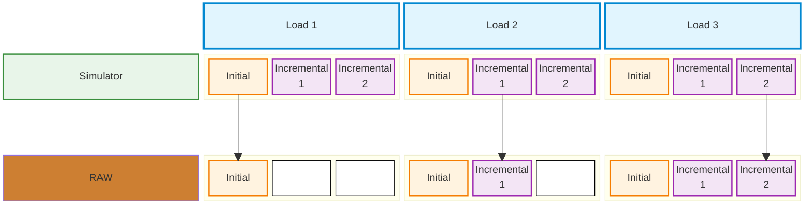

Therefore, it occupies the largest storage volume in modern DWHs.

#### "Silver" Zone and "Product" Dimension

This zone is the most complex in terms of implementation. We have fully described the "bronze" zone and formulated the requirements for the "gold" zone. Let's look at what we currently have using a single entity as an example:

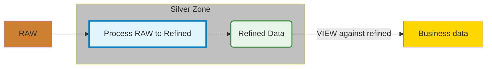

Data flows from `RAW` and must ultimately reach the `Business Data` layer. As we previously determined for the "gold" zone, it will be implemented as a view built on top of the `Refined Data` table in the "silver" zone. 
The task is to select the format for this table and the process for populating it (`Process RAW to Refined`).

First, let's establish a naming convention. Since SQLite lacks schema support, we will use prefixes. We have already started using them for the `RAW` zone, and now we will introduce them for the two additional zones:

* For the `RAW` zone, we used the `raw` prefix, for example, `rawProduct` or `rawEntity` for an arbitrary entity.
* For refined data, we will use the `ref` prefix, for example, `refProduct` or `refEntity`.
* For business data views, we will use a prefix based on the entity type, for example, `dimCustomer`, `factSales`, or `dimEntity` for an arbitrary entity.

Now let's update the diagram to reflect the introduced naming conventions:

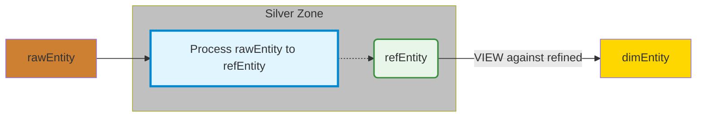

The right side between `refEntity` and `dimEntity` is implemented quite simply: we need to create a view that reads data from the table and presents it in a business-friendly format. There are three main operations involved:

* Field filtering: not all fields need to be exposed; in particular, we hide auxiliary fields.
* Renaming the necessary fields to business-friendly names.
* Substituting human-readable values from a list of allowed values for numeric or boolean fields.

There is no actual pipeline here: the view is bound to the table, and no explicit data movement execution is required.

Conceptually, this implementation looks as follows:

```SQL
CREATE VIEW dimEntity
AS
SELECT
   e_code AS "Business Code"
  ,e_name AS "Business Name"
  ,CASE WHEN e_is_active = 1 THEN 'Yes' ELSE 'No' END AS "Record Is Active"
-- other fields to be used

-- skip auxiliary fields like refEntity.e_some1, refEntity.e_some2, etc.
FROM refEntity
```

We rename the `e_code` and `e_name` fields, and substitute human-readable values for the `e_is_active` field. Meanwhile, the technical fields `e_some1` and `e_some2` are excluded from the selection.

It is important to note that the field names in `refEntity` are chosen here to closely match the business names in the final view. For example, for the "Product" dimension, the view can be created as follows:

```SQL
CREATE VIEW dimProduct
AS
SELECT
    prd_sk AS Product_Key
   ,prd_code AS "Product Code"
   ,prd_name AS "Product Name"
   ,prd_cost AS "Product Cost"
   ,prd_start_date AS "Product Effective Start Date"
   ,prd_end_date AS "Product Effective End Date"
   ,CASE
       WHEN prd_start_date <= CURRENT_DATE AND prd_end_date > CURRENT_DATE
           THEN 'Yes'
           ELSE 'No'
    END AS "Is Current Product"
FROM refProduct
```

The fields in the `refProduct` table, which we have not yet implemented, mostly do not match the fields in the `rawProduct` table and are chosen with readability in mind. For example, instead of `prd_start_dt`, the field `prd_start_date` is used to avoid ambiguity: the `dt` suffix does not clarify whether the field format is `DATETIME` or `DATE`. Thus, field renaming is one of the operations.

Let's add this to the diagram in a general form, without arrows, as a kind of task list:

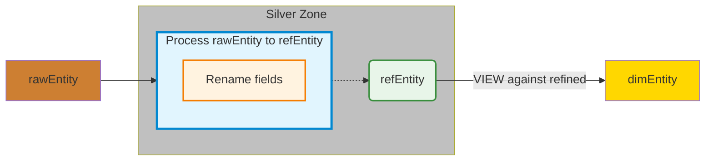

Obviously, we need to add a few more elements to such a list:

* Since we don't need the entire volume from `rawEntity` to process the next data batch, we need to add a filter `LOAD_TS_UTC = CurrentLoadTsUTC` to limit it to only the currently loaded batch. Let's denote this as `Current load filter`.
* Besides renaming fields, it may be necessary to convert them to the selected format. For example, all dates should be in `YYYY-MM-DD` format. Also, `NULL` values for dates should be replaced with certain sentinel dates for easier comparison operations, for example, `9999-01-01` for interval end dates. All string data should have whitespace characters removed from the beginning and end of the string. Let's denote this as `Fields formatting`.

Then the diagram transforms as follows:

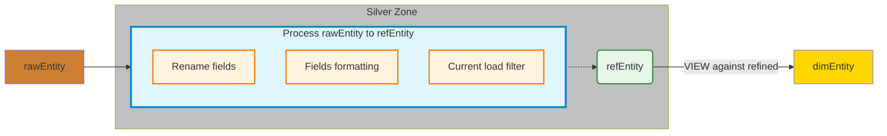

Such a set of operations, which does not apply business rules but only corrects data and field names, constitutes the `Staging` zone in the Pragmatic Data Platform ([Pragmatic data platform](https://github.com/pragmatic-data/pragmatic-data-platform)), which does not have a `RAW` copy:

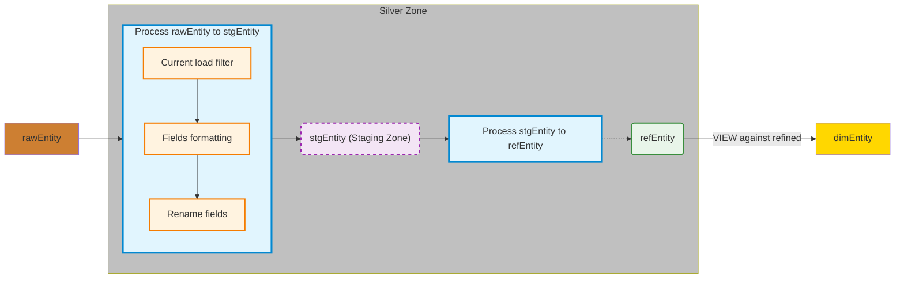

When the query plan is executed, the filter is applied first, followed by the formatting operations, and finally, the fields are renamed.
The `Staging` zone can be implemented either as a separate table or as a CTE, which is why it is denoted with a dashed line.

In this zone we have essentially the same fields as in `refEntity`, and all that remains is to implement the `UPSERT` operation within the `Process stgEntity to refEntity` block:

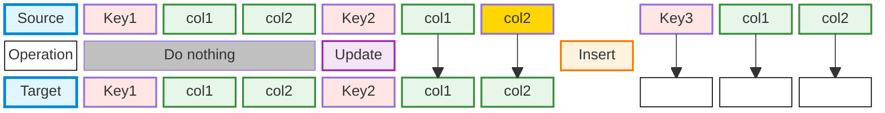

For this operation, the `Source` and `Target` tables must have a unique key consisting of one or more fields, for example `Key1`.
Then, if the records have two significant fields, `col1` and `col2`, and the values are the same in both `Source` and `Target`, nothing is done.
If the value of at least one field differs, the data in `Target` is updated. If the key `Key3` is not present in `Target`, a new record is inserted with this key and the corresponding field values.

This scheme is inconvenient when there are many tracked fields. It is more efficient to introduce one additional field, `HDIFF`, which will hold a hash or a simple concatenation of the fields that need to be checked for changes:

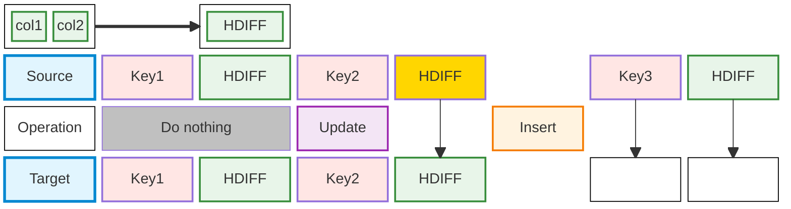

Then, when performing `UPSERT`, only `HDIFF` is compared, while all fields except the key are updated, and on insert the key itself is added as well.

In SQLite syntax, such a query looks as follows:

```SQL
INSERT INTO refEntity (key, col1, col2, HDIFF)
SELECT key, col1, col2, HDIFF
FROM stgEntity
WHERE true
ON CONFLICT(key) DO UPDATE SET
    col1  = excluded.col1,
    col2  = excluded.col2,
    HDIFF = excluded.HDIFF
WHERE refEntity.HDIFF IS NOT excluded.HDIFF;
```

In a similar way, we can introduce a composite field `HKEY` for the case where the table key is composite.
It is important to note that for this SQL syntax to work, the `stgEntity` table must have a unique key on the `key` field.

Now we can describe all the tables in the zones and the sequence of data movement from the source to the final representation for business analysis.
For the "Product" dimension, the picture of the fields across the zones looks as follows:

| `simProduct` | `rawProduct`  | `stgProduct`       | `refProduct`       | `dimProduct`                 |
| ------------ | ------------- | ------------------ | ------------------ | ---------------------------- |
| prd_id       | prd_id        | ***prd_sk***       | ***prd_sk***       | Product_Key                  |
| prd_key      | prd_key       | prd_code           | prd_code           | Product Code                 |
| prd_nm       | prd_nm        | prd_name           | prd_name           | Product Name                 |
| prd_cost     | prd_cost      | **prd_cost**       | **prd_cost**       | Product Cost                 |
| prd_start_dt | prd_start_dt  | **prd_start_date** | **prd_start_date** | Product Effective Start Date |
| prd_end_dt   | prd_end_dt    | **prd_end_date**   | **prd_end_date**   | Product Effective End Date   |
|              | LOAD_TS_UTC   | LOAD_TS_UTC        | LOAD_TS_UTC        |                              |
|              | RECORD_SOURCE | RECORD_SOURCE      | RECORD_SOURCE      |                              |
|              |               | *HDIFF*            | *HDIFF*            |                              |
|              |               |                    |                    | Is Current Product           |

Here, the fields whose changes we track are shown in bold. The single field `HDIFF`, which allows changes to be tracked by comparing only that field, is shown in italics. The unique key `prd_sk` is shown in bold italics. We changed its name so as not to confuse it with the `id` or `key` suffixes used in the sources.

Thus, the complete pipeline diagram from `rawProduct` to `refProduct` looks as follows:

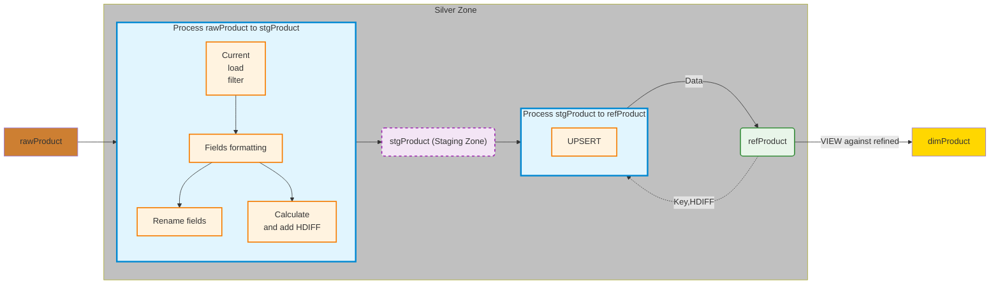

The complete pipeline from the source `simProduct` to the business representation `dimProduct` can be depicted as follows:
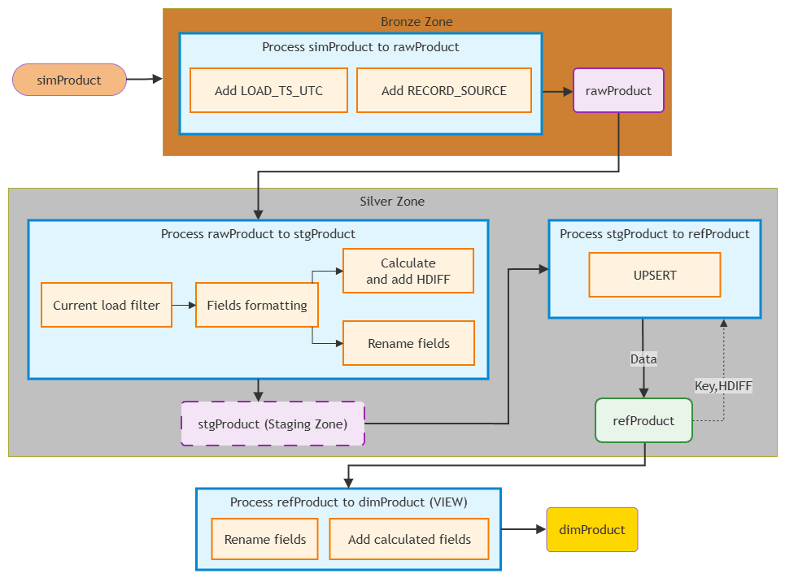

We already have part of the implementation of the complete pipeline, described earlier, namely:

* Data ingestion into `rawProduct`, i.e., the `Process simProduct to rawProduct` block.
* The implementation of the "gold" zone, i.e., the `Process refProduct to dimProduct (VIEW)` block.

Now we can write the implementation of the "silver" zone. First, we will create the `refProduct` table, for which all field definitions already exist:

```SQL
CREATE TABLE refProduct (
    prd_sk           INTEGER,
    prd_code         TEXT,
    prd_name         TEXT,
    prd_cost         INTEGER,
    prd_start_date   TEXT,
    prd_end_date     TEXT,
    
-- ** storing the history  **
    LOAD_TS_UTC      INTEGER,  -- load timestamp (UTC)
    RECORD_SOURCE    TEXT,     -- source
-- ** columns difference  **
    HDIFF            TEXT
);

-- unique key index
CREATE UNIQUE INDEX UQ_refProduct_prd_sk ON refProduct(prd_sk);
```

Next, we will write a query to populate the `refProduct` table:

```SQL
WITH tfmProduct AS -- Transform "Zone"
(
 SELECT 
    rp.prd_id AS prd_sk,
    TRIM(rp.prd_key) AS prd_code,
    TRIM(rp.prd_nm) AS prd_name,
    rp.prd_cost AS prd_cost,
    rp.prd_start_dt AS prd_start_date,
    COALESCE(rp.prd_end_dt,'9999-01-01') AS prd_end_date,
    rp.LOAD_TS_UTC,
    rp.RECORD_SOURCE
 FROM rawProduct AS rp
 INNER JOIN simCurrentLoadScenario AS cls
   ON cls.tls_id = rp.LOAD_TS_UTC
)
,stgProduct AS -- STG "Zone"
(
 SELECT 
   *,
   concat_ws('|',prd_cost,prd_start_date,prd_end_date) AS HDIFF
 FROM tfmProduct
)
INSERT INTO refProduct -- UPSERT
SELECT *
FROM stgProduct
WHERE true
ON CONFLICT(prd_sk) DO UPDATE 
SET
    prd_code  = excluded.prd_code,
    prd_name  = excluded.prd_name,
    prd_cost  = excluded.prd_cost,
    prd_start_date  = excluded.prd_start_date,
    prd_end_date  = excluded.prd_end_date,
    LOAD_TS_UTC  = excluded.LOAD_TS_UTC,
    RECORD_SOURCE  = excluded.RECORD_SOURCE,
    HDIFF = excluded.HDIFF
WHERE refProduct.HDIFF IS NOT excluded.HDIFF;
```

The additional CTE `tfmProduct` could have been omitted, but with it the code turns out more convenient, since the calculation of the `HDIFF` field is then performed on already formatted fields, with the same names as in `refProduct`. Such code is more readable and does not mix two operations in one place, which would have happened without this CTE. Otherwise, the code for the field value would look like this: `concat_ws('|',rp.prd_cost,rp.prd_start_dt,COALESCE(rp.prd_end_dt,'9999-01-01')) AS HDIFF`.

In fact, we have moved part of the operations into a separate zone:

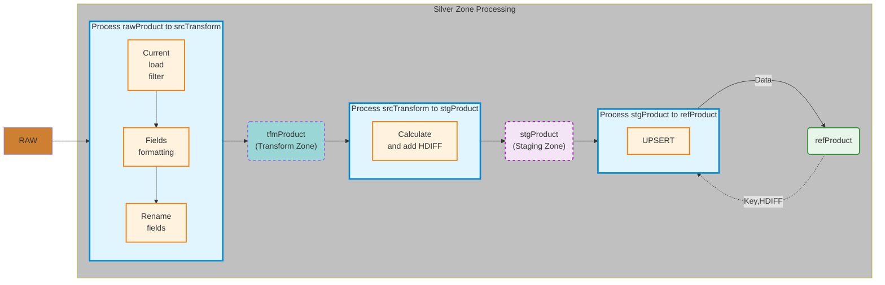

Such an approach with intermediate zones simplifies both writing the pipeline and debugging it. Indeed, it is relatively easy, right after the first `WITH` block, in which `tfmProduct` is defined, to insert `SELECT * FROM tfmProduct` and look at the data. `stgProduct` is checked in a similar way before the final debugging of the `UPSERT`.

To debug the "Product" dimension pipeline, we set `UPDATE simCurrentLoadScenario SET tls_id = 4;` in the simulator, thereby selecting the initial load scenario, and go through populating the `RAW` zone, and then the "silver" zone.

The results in `rawProduct` will be as follows:

| prd_id | prd_key    | prd_nm                      | prd_cost | prd_start_dt | prd_end_dt | LOAD_TS_UTC | RECORD_SOURCE |
|--------|------------|-----------------------------|----------|--------------|------------|-------------|---------------|
| 101    | TV-SD10-L  | Track Vest SporticsDog - L  | 10       | 2025-01-01   | 2025-03-01 | 4           | ERP           |
| 102    | TV-MC70-S  | Track Vest Mike and Cat - S | 5        | 2025-01-02   |            | 4           | ERP           |
| 103    | TV-JJ17-XS | Track Vest JJ Run - XS      | 7        | 2025-01-03   | 2025-02-05 | 4           | ERP           |
| 104    | TV-JJ17-XS | Track Vest JJ Run - XS      | 9        | 2025-02-05   |            | 4           | ERP           |

The results in `refProduct` will be as follows:

| prd_sk | prd_code   | prd_name                    | prd_cost | prd_start_date | prd_end_date | LOAD_TS_UTC | RECORD_SOURCE | HDIFF                      |
|--------|------------|-----------------------------|----------|----------------|--------------|-------------|---------------|----------------------------|
| 101    | TV-SD10-L  | Track Vest SporticsDog - L  | 10       | 2025-01-01     | 2025-03-01   | 4           | ERP           | 10\|2025-01-01\|2025-03-01 |
| 102    | TV-MC70-S  | Track Vest Mike and Cat - S | 5        | 2025-01-02     | 9999-01-01   | 4           | ERP           | 5\|2025-01-02\|9999-01-01  |
| 103    | TV-JJ17-XS | Track Vest JJ Run - XS      | 7        | 2025-01-03     | 2025-02-05   | 4           | ERP           | 7\|2025-01-03\|2025-02-05  |
| 104    | TV-JJ17-XS | Track Vest JJ Run - XS      | 9        | 2025-02-05     | 9999-01-01   | 4           | ERP           | 9\|2025-02-05\|9999-01-01  |

Finally, we check the data in `dimProduct` of the "gold" zone:

| Product_Key | Product Code | Product Name                | Product Cost | Product Effective Start Date | Product Effective End Date | Is Current Product |
|-------------|--------------|-----------------------------|--------------|------------------------------|----------------------------|--------------------|
| 101         | TV-SD10-L    | Track Vest SporticsDog - L  | 10           | 2025-01-01                   | 2025-03-01                 | No                 |
| 102         | TV-MC70-S    | Track Vest Mike and Cat - S | 5            | 2025-01-02                   | 9999-01-01                 | Yes                |
| 103         | TV-JJ17-XS   | Track Vest JJ Run - XS      | 7            | 2025-01-03                   | 2025-02-05                 | No                 |
| 104         | TV-JJ17-XS   | Track Vest JJ Run - XS      | 9            | 2025-02-05                   | 9999-01-01                 | Yes                |

After that, we update the current scenario (`tls_id`) in the simulator to 5 and 6 - to test the first and second incremental loads - and run the testing in the same sequence.
This completes the implementation and debugging of the "Product" dimension.

#### The "Silver" Zone and the "Customer" Dimension

Let's describe the distribution of the dimension's fields across the zones in the same way as was done for the "Product" dimension:

| `simCustomer`   | `rawCustomer`   | `stgCustomer`        | `refCustomer`        | `dimCustomer`               |
| --------------- | --------------- | -------------------- | -------------------- | --------------------------- |
| cst_id          | cst_id          | ***cst_sk***         | ***cst_sk***         | Customer_Key                |
| cst_key         | cst_key         | cst_code             | cst_code             | Customer Code               |
| cst_firstname   | cst_firstname   | **cst_firstname**    | **cst_firstname**    | Customer First Name         |
| cst_lastname    | cst_lastname    | **cst_lastname**     | **cst_lastname**     | Customer Last Name          |
| cst_create_date | cst_create_date | **cst_updated_date** | **cst_updated_date** | Customer Last Modified Date |
|                 | LOAD_TS_UTC     | LOAD_TS_UTC          | LOAD_TS_UTC          |                             |
|                 | RECORD_SOURCE   | RECORD_SOURCE        | RECORD_SOURCE        |                             |
|                 |                 | *HDIFF*              | *HDIFF*              |                             |

As can be seen, the "bronze" and "gold" zones here look similar, so their implementation will not be difficult. It is provided in the GitHub repository. The source here is "CRM".

The implementation of the "silver" zone here is somewhat different, since there may be several records for the same key. We need to select the most recent record among such duplicates by key, so additional operations will appear in the pipeline implementation:

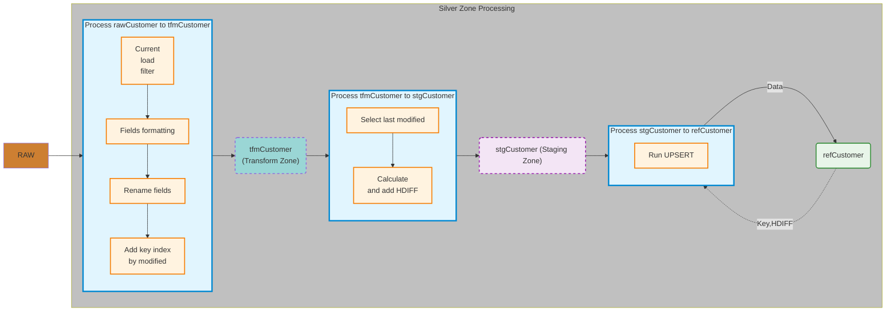

Since the dimension has only one date and its conversion to another format is not required, the index can be computed directly in the `tfmCustomer` zone by the `Add key index by modified` operation, which is implemented as `ROW_NUMBER()` ordered by descending date for the surrogate key. Then, in the `stgCustomer` zone, we need to select only the row with an index equal to one, in order to take only the latest change. This is done by the `Select last modified` operation. The index itself, as an additional field, is not needed among the fields of the `stgCustomer` zone and therefore is absent from the field-mapping table between the zones. `HDIFF` is calculated over other fields, but its essence is the same. Data transfer into `refCustomer` is performed in the same way as the transfer in the "Product" dimension.

The full code of the "silver" zone looks as follows:

```SQL
WITH tfmCustomer AS
(
 SELECT 
    rc.cst_id AS cst_sk,
    TRIM(rc.cst_key) AS cst_code,
    TRIM( COALESCE(rc.cst_firstname,'') ) AS cst_firstname,
    TRIM( COALESCE(rc.cst_lastname,'') ) AS cst_lastname,
    rc.cst_create_date AS cst_updated_date,
    rc.LOAD_TS_UTC,
    rc.RECORD_SOURCE,
    ROW_NUMBER() OVER (PARTITION BY rc.cst_id ORDER BY rc.cst_create_date DESC ) AS date_idx
 FROM rawCustomer AS rc
 INNER JOIN simCurrentLoadScenario AS cls
   ON cls.tls_id = rc.LOAD_TS_UTC
)
,stgCustomer AS
(
 SELECT 
   cst_sk,
   cst_code,
   cst_firstname,
   cst_lastname,
   cst_updated_date,
   LOAD_TS_UTC,
   RECORD_SOURCE,
   concat_ws('|',cst_firstname,cst_lastname,cst_updated_date) AS HDIFF
FROM tfmCustomer
WHERE date_idx = 1
)
INSERT INTO refCustomer
SELECT *
FROM stgCustomer
WHERE true
ON CONFLICT(cst_sk) DO UPDATE 
SET
    cst_code = excluded.cst_code,
    cst_firstname = excluded.cst_firstname,
    cst_lastname = excluded.cst_lastname,
    cst_updated_date = excluded.cst_updated_date,
    LOAD_TS_UTC = excluded.LOAD_TS_UTC,
    RECORD_SOURCE = excluded.RECORD_SOURCE,
    HDIFF = excluded.HDIFF
WHERE refCustomer.HDIFF IS NOT excluded.HDIFF;
```

Since we do not include the `date_idx` field in the `stgCustomer` zone, the fields in the query are listed explicitly.

To debug the pipeline of this dimension, we set `UPDATE simCurrentLoadScenario SET tls_id = 1;` in the simulator, and then follow the same sequence as for the "Product" dimension, but then choosing the values 2 and 3.
This completes the implementation and debugging of the "Customer" dimension.

#### The "Silver" Zone and the "Sales" Fact

Let's describe the distribution of the "Sales" fact's fields across the zones:

| `simSales`   | `rawSales`    | `stgSales`         | `refSales`         | `factSales`               |
| ------------ | ------------- | ------------------ | ------------------ | ------------------------- |
| sls_ord_num  | sls_ord_num   | *sls_order_number* | *sls_order_number* | Sales Order Number        |
| sls_prd_key  | sls_prd_key   |                    |                    |                           |
| sls_cust_id  | sls_cust_id   | *sls_cst_sk*       | *sls_cst_sk*       | Customer_Key              |
| sls_order_dt | sls_order_dt  | sls_order_date     | sls_order_date     | Sales Order Date          |
| sls_ship_dt  | sls_ship_dt   | sls_ship_date      | sls_ship_date      | Shipment Date             |
| sls_due_dt   | sls_due_dt    | sls_due_date       | sls_due_date       | Delivery Due Date         |
| sls_sales    | sls_sales     | sls_prd_sales      | sls_prd_sales      | Product Sales (per Order) |
| sls_quantity | sls_quantity  | sls_prd_quantity   | sls_prd_quantity   | Item Quantity             |
| sls_price    | sls_price     |                    |                    |                           |
|              | LOAD_TS_UTC   | LOAD_TS_UTC        | LOAD_TS_UTC        |                           |
|              | RECORD_SOURCE | RECORD_SOURCE      | RECORD_SOURCE      |                           |
|              |               | *sls_prd_sk*       | *sls_prd_sk*       | Product_Key               |
|              |               | ***HKEY***         | ***HKEY***         |                           |

The table differs from those of the dimensions, so some explanation is required:

* The product code and price are absent from the fact, since they already exist in the "Product" dimension.
* The fields are renamed in the `STG` zone for greater clarity of their purpose.
* The field `sls_prd_sk` is calculated as `prd_sk` for the product according to the range of its validity on the order date `sls_order_date`.
* In the `STG` zone and further in `factSales`, the `HDIFF` field, which was present in the dimensions, is absent, since we do not update sales facts and tracking changes in the data is not required.
* There is an `HKEY` field, which is a composite unique key. It includes the fields `sls_order_number`, `sls_cst_sk`, `sls_prd_sk`, shown in italics. It is precisely this combination of order number, customer, and product that is unique.

Then the schema of the "silver" zone pipeline is as follows:

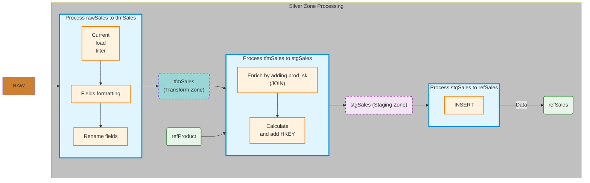

The set of tasks in the transformation zone `tfmSales` here is the same as in the "Product" dimension. The set of tasks in the `stgSales` zone, however, differs in that data enrichment is introduced by calculating the product's surrogate key according to the range of validity from `refProduct`,where the product data has already been cleansed. This means that `refSales` must be populated after `refProduct` has been populated. Since we do not update the sales fact, the `INSERT` operation is sufficient. However, to avoid duplicates, the unique key `HKEY` is checked. It is calculated after the enrichment.

The full code of the "silver" zone looks as follows:

```SQL
WITH tfmSales AS
(
 SELECT 
    TRIM(rs.sls_ord_num) AS sls_order_number,
    TRIM(rs.sls_prd_key) AS sls_prd_code,
    rs.sls_cust_id AS sls_cst_sk,
    substr(rs.sls_order_dt, 1, 4) || '-' ||
      substr(rs.sls_order_dt, 5, 2) || '-' ||
      substr(rs.sls_order_dt, 7, 2) AS sls_order_date,

    substr(rs.sls_ship_dt, 1, 4) || '-' ||
      substr(rs.sls_ship_dt, 5, 2) || '-' ||
      substr(rs.sls_ship_dt, 7, 2) AS sls_ship_date,
      
    substr(rs.sls_due_dt, 1, 4) || '-' ||
      substr(rs.sls_due_dt, 5, 2) || '-' ||
      substr(rs.sls_due_dt, 7, 2) AS sls_due_date,
          
    rs.sls_sales AS sls_prd_sales,
    rs.sls_quantity AS sls_prd_quantity,
    rs.LOAD_TS_UTC,
    rs.RECORD_SOURCE
 FROM rawSales AS rs
 INNER JOIN simCurrentLoadScenario AS cls
   ON cls.tls_id = rs.LOAD_TS_UTC
)
,stgSales AS
(
 SELECT 
   t.sls_order_number,
   p.prd_sk AS sls_prd_sk,
   t.sls_cst_sk,
   t.sls_order_date,
   t.sls_ship_date,
   t.sls_due_date,
   t.sls_prd_sales,
   t.sls_prd_quantity,
   t.LOAD_TS_UTC,
   t.RECORD_SOURCE,
   concat_ws('|',t.sls_order_number,t.sls_cst_sk,p.prd_sk) AS HKEY
FROM tfmSales AS t
INNER JOIN refProduct AS p
  ON p.prd_code = t.sls_prd_code
  AND t.sls_order_date >= p.prd_start_date
  AND t.sls_order_date < p.prd_end_date
)
INSERT INTO refSales
SELECT *
FROM stgSales
WHERE true
ON CONFLICT(HKEY) DO NOTHING;
```

The longest part of the code is the conversion of dates from the format without hyphens to the format with hyphens. The rest of the code is already familiar to you, except for the enrichment. The enrichment uses an inner join with `refProduct`, since the simulator data is known to be correct. The interval for SCD 2 is always half-open: the end date of validity is not included, so the `BETWEEN` operator cannot be used.

To debug the fact pipeline, one must first fully load the data into the "Product" dimension, and then we set `UPDATE simCurrentLoadScenario SET tls_id = 7;` in the simulator and follow the same sequence as for the dimensions, but choosing the values 8 and 9.
This completes the implementation and debugging of the "Sales" fact.

#### Loading All Data and Dependencies

Until now, we tested loading one entity at a time: first the "Product" dimension, then the "Customer" dimension, and finally the "Sales" fact. In real life, data can, as a rule, appear in all three entities simultaneously. The data simulator also has such a mode, but first the data in the `RAW` and `REF` zone tables must be cleared.
The easiest way to do this is to add an update trigger to the `simCurrentLoadScenario` table: if we set the reserved cleanup mode with the number 10, then we clear the data in all DWH tables.
The trigger is fairly simple; here is its code:

```SQL
CREATE TRIGGER clear_raw_ref_when_tls_id_is_10
AFTER UPDATE OF tls_id ON simCurrentLoadScenario
WHEN NEW.tls_id = 10 AND OLD.tls_id <> 10
BEGIN
  DELETE FROM rawProduct;
  DELETE FROM rawCustomer;
  DELETE FROM rawSales;
  DELETE FROM refProduct;
  DELETE FROM refCustomer;
  DELETE FROM refSales;
END;
```

Then, when the query `UPDATE simCurrentLoadScenario SET tls_id = 10;` is executed, all data in the tables will be cleared.

When loading all entities simultaneously, it is important to remember the dependency between them. First the "bronze" zone is loaded, then the "silver" one. Loading either of the two dimensions did not require that data already exist somewhere, but loading the "silver" zone of the "Sales" fact requires that the "silver" zone for the "Product" dimension has been loaded.
Dependencies of this kind are represented graphically as a directed graph, where the arrows show the sequence of transitions. Since such graphs have no cycles, they are called acyclic, or, for short, a DAG.
This is what the DAG for loading our DWH looks like:

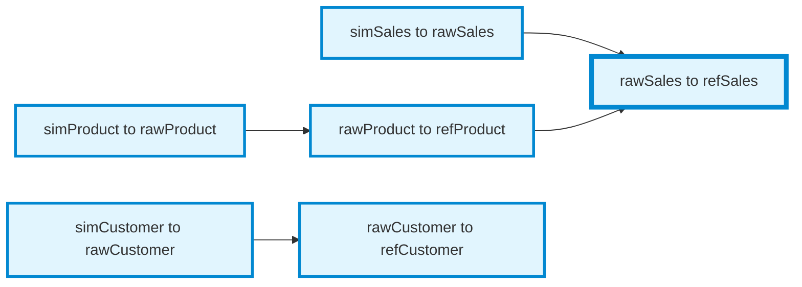

The task `rawSales to refSales` is highlighted with a bold border, since it depends on two tasks that must be completed before it is invoked. All tasks of the form `simXXX to rawXXX` depend on nothing, and they can all be executed in parallel. Also in parallel, after the corresponding `simXXX to rawXXX` task has been completed, the tasks `rawProduct to refProduct` and `rawCustomer to refCustomer` can be executed. The task `rawSales to refSales`, however, must first wait for `rawProduct to refProduct` to finish.
DAGs of this kind are usually executed by orchestrators, such as Airflow. dbt can also act as an orchestrator, if the data lineage, that is, the dependency of the data on one another, is described in it.
In our case, for a simple DWH, one can sequentially execute first all `simXXX to rawXXX` tasks, then `rawProduct to refProduct` and `rawCustomer to refCustomer`, and finally `rawSales to refSales`.

Therefore, in the `src` directory of the repository there are two subdirectories:
* `test_by_entity`: for testing the pipeline's operability one entity at a time.
* `test_all_entities`: for testing the pipeline's operability for all entities simultaneously.

To test everything, one must first clear the data by calling `UPDATE simCurrentLoadScenario SET tls_id = 10;`, and then sequentially check the scenario numbers (`tls_id`) with the values 11, 12, and 13. All data must be correct in the `RAW` and `REF` zones at each testing step.
## Conclusion

We have explored the process of building a DWH with a medallion architecture and a data pipeline based on a simple SQLite database, enhanced by the principles of the Pragmatic Data Platform. Using small test datasets and a data simulator makes debugging algorithms on such a prototype straightforward. Applying intermediate zones, which can be implemented as separate CTE blocks within a query, simplifies both the separation of logic and its debugging. Once debugged, these algorithms can be seamlessly reused when migrating to more complex data storage systems.
A separate note regarding the `INSERT INTO ... SELECT *` syntax in the examples: it was used exclusively to keep the code concise and easy to read. In the actual scripts on GitHub, only explicit column lists are used, as is standard in best practices.

The test data was intentionally kept clean and correct to avoid overcomplicating the implementation logic. Upgrading the pipeline to handle incomplete, inconsistent, or malformed data, as often encountered in real-world systems, will be covered in a separate article.
## References

* [Productionizing Machine Learning with Delta Lake](https://www.databricks.com/blog/2019/08/14/productionizing-machine-learning-with-delta-lake.html) by Brenner Heintz and Denny Lee
* [Announcing the Databricks Delta](https://www.databricks.com/company/newsroom/press-releases/databricks-launches-delta-combine-best-data-lakes-data-warehouses-streaming-systems)
* [Pragmatic data platform](https://github.com/pragmatic-data/pragmatic-data-platform)
* Source code for this article: [DWH Step By Step Part 3](https://github.com/dyacc11/DWH-StepByStep/tree/main/Part_03)
